# Changelog

What changed in each version of Glassio. Downloads: [Releases](https://github.com/mohammadmrh12/glassio/releases) · [العربية](docs/CHANGELOG.ar.md)

## 3.7.0 — your picture as the settings button, Menu & themes in groups, hide an app's rows

- **The settings button** (Settings → Menu & themes): *Hello*, the handwriting *hello* in its pill again, *Menu*, or
  **your own picture** in a circle — scan the QR code on the TV and press *Upload a picture* on your phone (or use a link).
  Next to a picture the clock is a little larger.
- **Menu & themes in groups**: *Top bar* (the settings button, clock, date and weather, auto-hide — moved here from
  Background & glass and Dock & icons), *Look*, *Menu* (with what shows in it) and *TV inputs*; rows under a switch that
  is off are hidden.
- **Hide an app's rows**: hold OK on an app with channels → *Hide its rows* / *Show its rows*.
- **Sync**: *Performance* is its own part, off unless you turn it on, so a weaker TV keeps its own settings; turned off,
  the TV goes back to its own performance mode.
- **The What's new tour** shows only the new version, and on its last page (the GitHub QR code) only OK closes it.

## 3.6.0 — Sync between your TVs, your Nuvio profile, the settings button
- **Sync** (Settings → Sync): one TV is the main one, the others follow it over your home network, live (a change on
  the main TV shows on them a moment later) or only when you press Sync now. Found on their own, paired once with a
  4-digit code shown on the main TV. Each TV chooses what it takes: look and theme, dock and icons, home screen,
  channels and music, screensaver, add-ons and catalogs, library and likes. Off unless you turn them on: keys (TMDB,
  Unsplash, Home Assistant), the Hue bridge, cameras and doorbell, remote buttons, the app lock. Never synced:
  sign-ins (Nuvio, Stremio, Trakt, Simkl), performance and HDMI inputs. Pause sharing on the main TV to try things
  out; one way only, from the main TV to the others.
- **Nuvio profile** (Settings → Connections): Continue Watching, the Library and the account's add-ons can follow
  another of your account's profiles (#16).
- **The settings button** (Settings → Menu & themes): sliders, a gear, dots, lines, a person or "hello", in a rounded
  square, a circle or no frame, with a soft shadow over bright pictures.
- **Backups** say what moves to another TV and what stays, and ask before a restore replaces everything.

## 3.5.0 — Channels: an app's rows in the carousel's place, music apps and the Music icon
- **Channels** (Settings → Channels): select an app in the dock (YouTube, Shahid, Prime Video, Netflix…) and its rows
  (Continue watching, Recommended…) take the carousel's place. ▲ goes into them, ▲ / ▼ moves between rows (one or two
  at a time, an app's other rows come in one by one), OK opens the card in its app, Back returns to the app.
  Layout, cards in a row, the Library's grey page or the selected card's picture blurred, the Library's zoom and glow,
  the app's name in its icon's colour, Hue lights following the card, and each app's rows hidden or reordered.
- **Music apps in the dock** show their player, also with nothing playing (Play carries on where the app left off,
  without opening it). Settings → Music / Channels: any music app can show its rows instead.
- **The Music icon** shows your music apps (drawn like the dock's tiles), or the player while a song plays: OK plays,
  hold OK opens the app. Pause, Stop and ▼ come back to the Music icon.
- **The player follows the app that starts playing** (SoundCloud after Spotify), and the island shows the song over the rows.
- **Nuvio and Stremio** always keep the carousel (the island shows what plays).
- **Catalogs with Torrentio**: an add-on link with "|" in it (Torrentio's settings) stopped every catalog from
  refreshing ("Illegal character in path", #15).

## 3.4.0 — trailer volume, clearer clock glass, more music apps, Hue and Glassio on remote buttons
- **Trailer volume** on the home screen (Settings → Carousel, and the menu's Trailer page) and in the Trailers
  screensaver (its settings and the hold-OK menu). The TV's own volume stays as it is.
- **Large clock glass**: how much the glass digits show, down to clear glass with just its rim (home screen and screensaver).
- **Music**: iHeart, SoundCloud, TuneIn, SiriusXM, Qobuz, Amazon Music and more; any app that says it is an audio app
  is followed and controlled by the player. Artwork from apps that only send a link to it (SoundCloud showed a grey
  square), and Glassio's own artwork for a song that has none.
- **Remote mapping**: a button can open **Glassio itself** (for a remote whose Home button doesn't work, #13), or turn
  a **Hue** room, zone or every light off (pressed again: on).
- **Hue sync**: every light gets its new colour at the same moment (a Bloom no longer lags behind the Play bars).
- **Smoother**: the dock opening (lighter veil), the carousel's slide settling, and Up held through the Library goes
  through Continue Watching to the dock without the row jumping sideways.
- **Fire TV**: "Allow Glassio" (TV access over ADB) works when the TV never asked at 127.0.0.1 (#14).

## 3.3.1 — HDMI inputs on plain-Android TVs, screensaver fixes
- **HDMI inputs** open on TVs running plain Android with their own UI (no Live TV app, e.g. Chinese boards with
  Wisdom UI): Glassio shows the input itself, full screen; Back comes home. Settings → Menu & themes → *Inputs open in*:
  Automatic, the TV's app or Glassio.
- **Trailers screensaver**: the title's picture shows while the first trailer loads (no black screen); without the
  internet it says so instead of "No trailers found", the note keeps moving (no burn-in on OLED), and the trailers come
  back by themselves when the connection does.
- Cleaner code: unused settings and icons removed, compiler warnings fixed.

## 3.3.0 — Trailers screensaver, glass colour, bold text and many fixes
- **Trailers screensaver** (Settings → Screensaver → *Type*, also in the menu's Screensaver page): the carousel's
  trailers one after another, with the title's logo and details like the carousel and subtitles above them. **OK**
  opens the title in Nuvio, **hold OK** opens a menu (Open in Nuvio, Next trailer, Library, Like, Sound), **◀ ▶** skip.
  Sound, Cinematic / Original size, logo, details, synopsis, subtitle size and how long the details show are all
  settings. The clock moves out of the logo's corner.
- **Posters screensaver**: OK opens the title on screen in Nuvio, ◀ ▶ go to the next or the one before.
- **Glass colour** (Settings → Menu & themes, and the menu's Themes): a tint through all the glass — dock, icons, menus,
  panels — **black** or **petrol**, still see-through like a tinted window, with its own strength. It stays the same
  while slides change.
- **Bold text** for all of Glassio's writing (Settings → Menu & themes).
- **Trailers**: when Cinemeta lists none, Glassio finds one on **TMDB**, then with a **YouTube search**; always the best
  quality the source has (up to the screen's own, 4K on a 4K TV); subtitles **one line at a time** (no more rolling up)
  with their own **size**; the window always stays on screen and shows with the first frame; they start sooner.
- **Settings remembers where you were**: it opens on the page and row you left.
- **Nothing selected, never**: after the Apps folder and Home, or an app opened from the folder, the selection always
  comes back.
- **Music mode**: the music page stays when you go down into the dock, and it no longer opens by itself when Glassio
  starts with a song left paused.
- **Carousel**: it plays on by itself while it is selected (a paused song stopped it), its work between slides is
  spread out (lower, steadier CPU), and the screensaver no longer stays running hidden behind it.
- **Library**: holding a button moves faster.
- **Settings**: more room between groups; the dock's look (blur, refraction, brightness, glow, icon zoom, corner
  radius, auto-hide) moved to **Dock & icons**; the screensaver's info is under *On screen*.
- The What's new tour shows everything new and always ends with a QR code to Glassio on GitHub.
- New defaults for new installs (trailers in full quality and a window, Music mode, the dock at the bottom…).

| | |
|---|---|
| 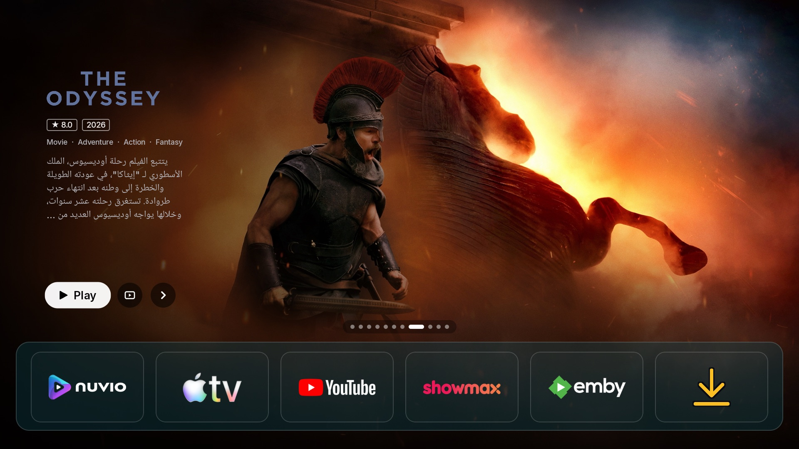 | 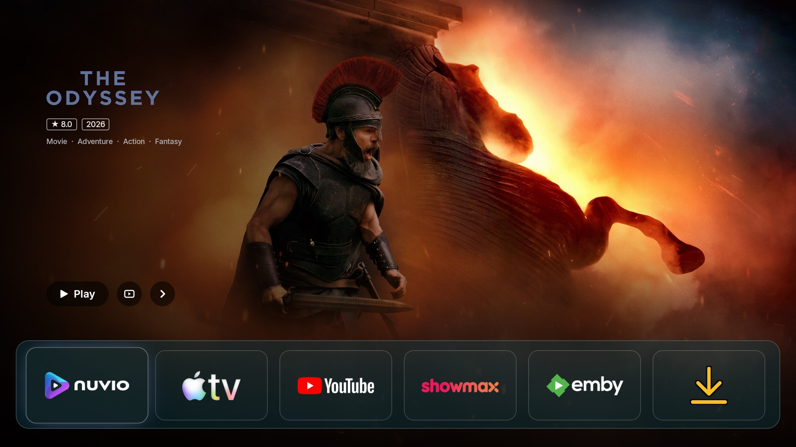 |
| 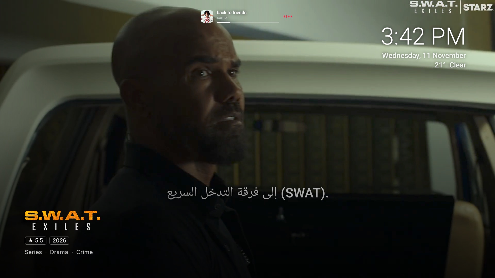 | 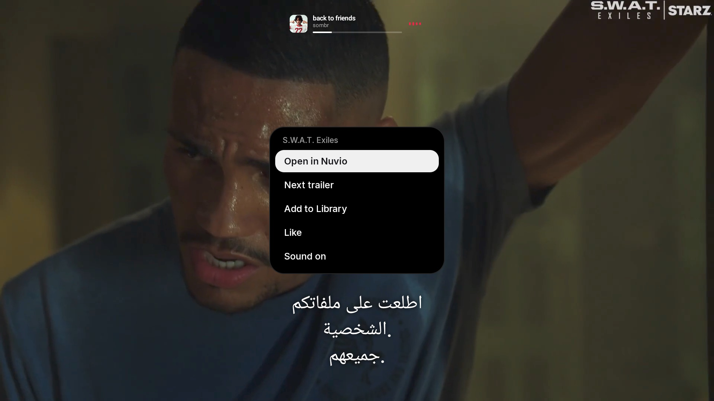 |
| 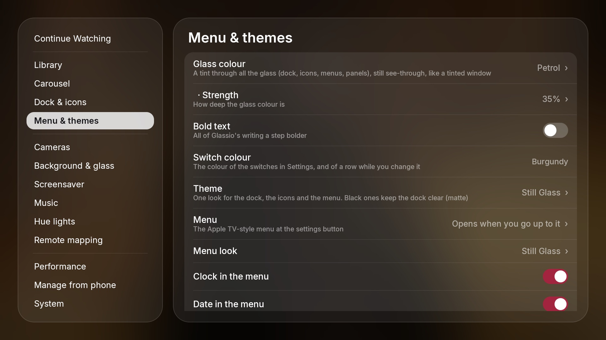 | 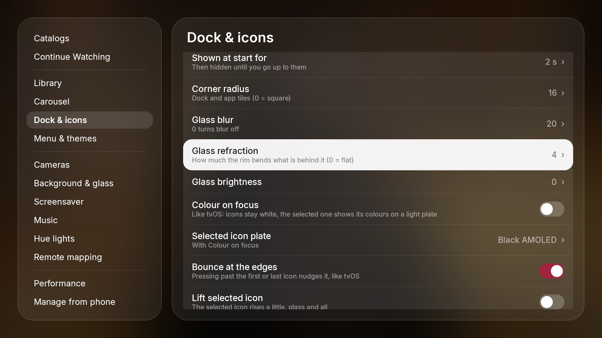 |
| 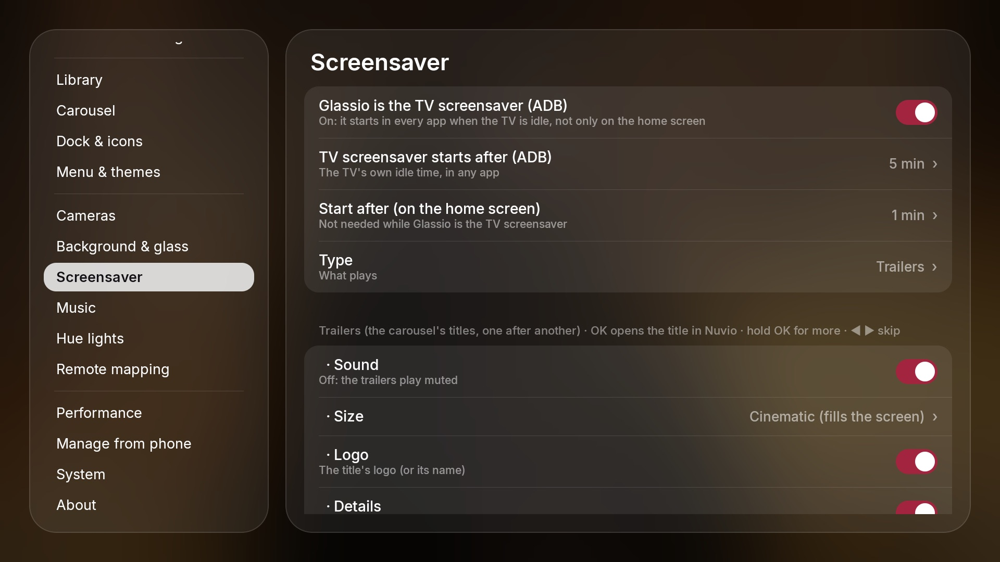 | 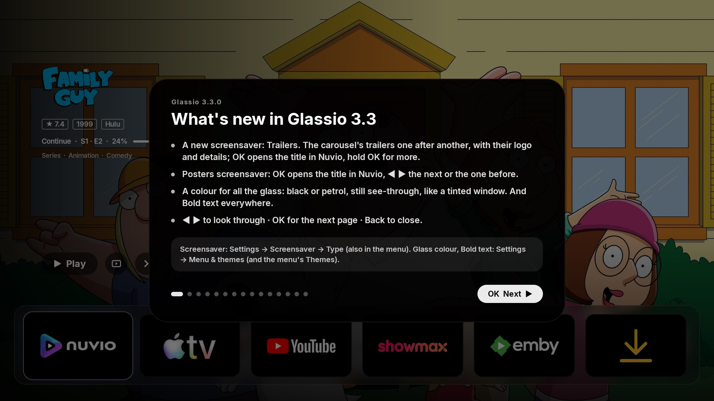 |
| 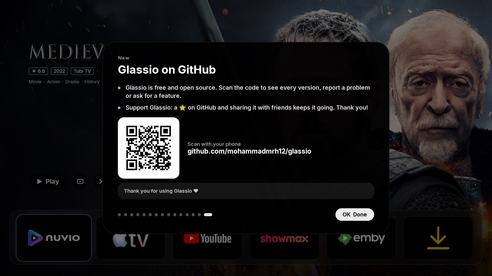 | 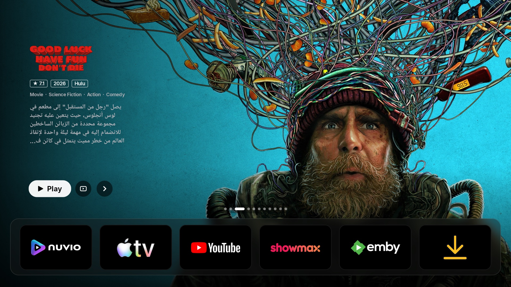 |
| 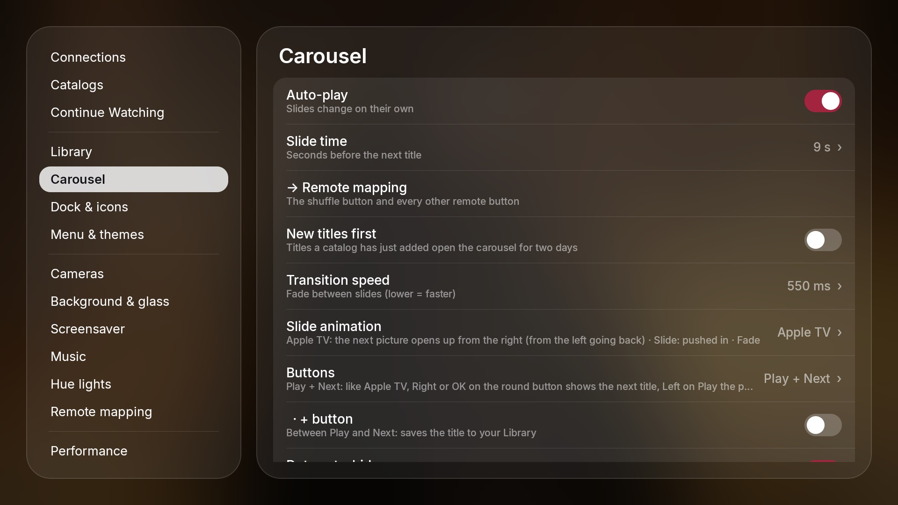 | 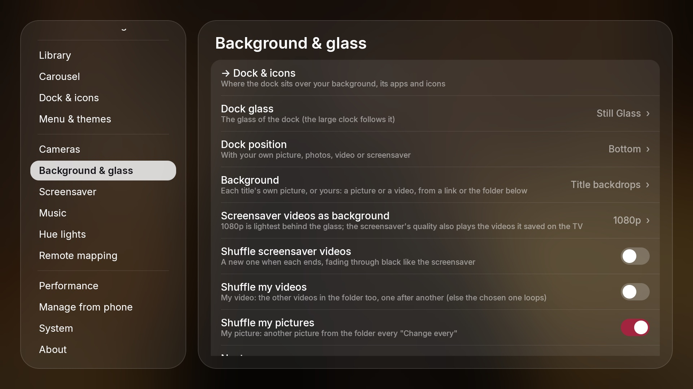 |

## 3.2.2 — Trailer fixes
- Trailers no longer stop by themselves after a few seconds, and their sound no longer plays twice: a remote
  button or Hold Home could open a second Glassio beside the home one, and both played the trailer.

## 3.2.1 — Every icon in a pack, icon search, Recent apps without USB debugging
- Icon packs now show **every icon** they include, also the ones not linked to an app — Projectivy / Blueprint style
  packs showed only part of theirs.
- **Search icons** in the icon picker (hold OK on an app → Change icon): type part of a name and every installed
  pack is searched at once.
- **Recent apps without USB debugging**: Glassio lists the apps you used lately from what its Home button service
  sees, so ADB no longer has to stay on. With USB debugging on the list is exact as before (switch: Settings →
  Remote mapping → *Recent apps use TV access*). Optional *Usage access* adds apps opened before Glassio started.

## 3.2.0 — Remote mapping
- **Remote mapping** (Settings → **Remote mapping**, #12): give any remote button an app, the **Apps folder**, the
  **recent apps** or a **TV input**; it works in any app (with the Home button service). Pressed again, the Apps folder
  and the recent apps close. Shuffle, multi-view, the corner camera, Hold Home and Back for the screensaver live here too.
- A locked app's menu (hold OK) asks for the code first; signing out of any account asks first.
- The row you change with ◀ ▶ takes the **Switch colour** (burgundy, green or purple).
- Fixed: in Music mode, opening the dock showed the carousel title behind it; the selection is always back after the
  screensaver, the Apps folder or the recent apps.

## 3.1.0 — Hue Sync, a new Settings with search, a self-hosted Nuvio
- **Hue Sync** (Settings → **Hue lights**): Philips Hue lights in the colours of what's on screen — the backdrop, the
  poster or the logo, your video background, trailers, the screensaver's videos and the music's artwork.
  - Each light follows its own part of the screen (left, right, top, corners, a gradient strip along the edges…, with
    pictures of each choice), or its place in a Hue **entertainment area**. *Blink it* shows which light is which.
  - Philips lights get colours inside their own range; other makes (Lidl Livarno, Tuya…) get hue and saturation.
  - Optional: the lights take the colour of the **app selected in the dock** or the **poster in the Library**, each with
    its own brightness.
  - Intensity, brightness, follow the picture's brightness, change speed; a new title's colours come at once.
  - When you open an app or a film, or the TV turns off: back as they were, dimmed, off or left.
- **Settings**: grouped like iPhone Settings (rounded cards, thin lines, a white selection), **search** with Glassio's
  own keyboard, quicker to open and to move through, and a **switch colour** (burgundy, green or purple).
- **Manage from phone**: redesigned like iPhone Settings, light and dark, with a search.
- **Nuvio**: a **self-hosted Nuvio backend** (server address, anon key, optional TV sign-in page) and sign-in with
  email (#11).
- **Home Assistant**: Glassio can send Nuvio's playback to Home Assistant and take pause / play / seek from it, without
  Home Assistant polling the TV.
- **Music**: the dock's Music icon opens the music page (even with Music mode off); Pause / Play show at once; names
  cross-fade in place; leaving a YouTube video keeps the music page and the selection.
- **Library**: holding Down glides at a steady pace (also with fast key repeat).
- **Cameras**: multi-view blurs everything behind it, on the home screen and the screensaver. The screensaver never
  starts during a trailer.

## 3.0.0 (and 2.0.8 – 2.0.10) — music, trailers, inputs and a new screensaver
- **What's new tour**: after an update, Glassio shows a short tour of what's new and where to switch each thing off or
  change it (Settings → About → *What's new* opens it again).
- **Music** (Settings → **Music**): Now Playing from any music app (Spotify, YouTube Music, Apple Music, Anghami,
  YouTube…).
  - **Music mode**: the home screen becomes a full-screen player with the blurred artwork, and songs cross-fade.
  - A small player in the menu (press ▶), a Music tile for the dock, and a **dynamic island** on the screensaver and the
    home screen: Up opens it with its controls, Down closes it.
  - Play, skip, **shuffle** (the same in every player) and **stop** from anywhere.
  - The island and the large clock follow your theme: black, white, frosted, clear or still glass.
- **Trailers**: a title's trailer plays in place of its picture, in Glassio's own player (no YouTube buttons, it starts
  in about a second), in **Cinematic** (fills the screen, its black bars cropped), **Original** or a small **Window**.
  - **Subtitles in your language**, translated when YouTube has none.
  - **Starts by itself** after a few seconds on a title, only while the carousel is selected (never from the dock).
  - A **Trailer** page in the menu (play / stop, starts by itself, size, dock, subtitles, sound), and **hold OK on a
    poster in the Library → Trailer**. The dock and the menus' glass follow the trailer.
- **Inputs**: the TV's HDMI inputs and HDMI-CEC devices (PlayStation, receiver…) in the menu and as dock icons.
- **Cameras**: multi-view with up to 4 cameras, Home Assistant cameras, remote buttons for multi-view and the corner
  camera.
- **Screensaver**: a large clock in your theme's glass (Up shows or hides it), hold OK to **lock** a video you like
  (*Locked only* plays just those), Down shows the cameras, and it closes smoothly through black.
- **Continue Watching** exactly as in Nuvio, with **Next Up** (the next episode of series you finished, #10), and
  *Open in* to choose the app for a Library title.
- **Smoother**: frosted glass slides as smoothly as clear glass, a faster start, a smoother carousel.

## 2.0.5 / 2.0.6 — backgrounds, a glass clock, app lock and the doorbell
- **Backgrounds** (Settings → **Background & glass**): title backdrops, **Photos in 4K** (Bing, Wikimedia Commons,
  Unsplash with a free key, or your own), **your own video**, or **the screensaver's videos**. Each has **Next** and
  **Shuffle**, fades like the screensaver and is kept in a cache that clears its oldest files. The place and credit
  can show on the background, like on the screensaver.
- **Large clock** over the background, made of the dock's glass (or white). Size, position and the **Glass blur**
  setting apply to it, and it follows a video background live.
- **Depth effect** for photos: the subject comes in front of the clock (done on the TV with a small depth model,
  only for pictures).
- **App lock**: lock any app with a 4-digit code (0000 by default). Hold OK on it → Lock. A glass code window opens it
  as soon as the code is right, with an optional hint. Only apps opened from Glassio are locked.
- **Doorbell from Home Assistant**: the camera pops up in the corner over any app, with a soft chime and your own words
  (ready-made Arabic or English). See [Doorbell](README.md#doorbell-pop-up).
- **Cameras**: *Find cameras* adds every channel of a recorder (NVR/XVR). You can choose the doorbell camera, make it go
  round your cameras, and set the size of the Hold Home camera.
- **Sharp corners** for the menus, dock and icons. New theme names: **Dynamic Glass**, **Still Glass**, **Frosted Glass**.
- Smoother glass in every theme, in step with the background, and much less memory with your own background.

## 2.0.4
- Coming back from Settings is smooth at once (the home screen and the Library are no longer rebuilt).
- **Sync** also carries removals made in Nuvio, on Trakt or on Simkl to the other accounts, and says what happened
  with each account. Glassio keeps within Simkl's daily request limit.
- Glass menus keep the remote inside them; the shuffle button works with any remote button.

## 2.0.3
- **Hold OK on Play**: a small glass menu to add the title to your Library, **Like** it (sent to Trakt and Simkl) or
  **change its artwork** from small pictures. Apps in the dock get the same glass menu.
- **Sync** (Settings → Connections): Library, likes and Continue Watching kept the same on Nuvio, Trakt and Simkl.
- **Shuffle button**: pick any remote button to shuffle the carousel; titles a catalog has just added come first.
- The corner camera can go round your cameras on its own.
- Logos appear faster, and the title's name shows when a logo is missing. Continue Watching switched off in the
  carousel stays in the Library.

## 2.0.2
- **Settings → Cameras**: everything about your cameras in one place, and you choose which camera opens when you hold
  Home and how long it stays (20 s by default).
- Back from standby, the TV opens Glassio again instead of the Google TV home.
- Screensaver videos and pictures always leave 3 GB free on the TV, and coming back from another app is faster.
- Down from Continue Watching lands on the poster right under the card.

## 2.0.1 — the Library scrolls like Apple TV
- One long, soft glide per press that keeps its speed when you hold Down, the selected row high on the page, rows
  built ahead, and a steady 60 fps on the TV (nothing is drawn under the page any more).
- Bigger focus zoom, a light shadow under every poster (deeper under the selected one), more room between rows, and
  posters loaded ahead into the cache. No more shake moving along a row, and the top of the page is never cut.
- Settings → Library: **poster size**, **posters in a row** and **space between posters**.

## 2.0.0 — smoother, faster navigation everywhere
- **Settings**: changing a look option (like *Settings background*) keeps your place and the remote stays in Settings;
  Right / OK always goes into the options (the dock behind can't take the remote any more). The section list fits
  on screen, and fast scrolling keeps the selected row steady instead of jumping.
- **Dock and Library**: opening and closing the dock is about a third lighter on the GPU, and fast Up from the
  Library stops at the dock instead of running on to the carousel and menu.

## 1.9.9
- **First-run setup**: a liquid-glass welcome — restore a backup, choose a look, sign in to Nuvio, Stremio, Trakt and
  Simkl with a QR code right there (✓ when connected), add catalogs from your phone, or *Later*.
- **Accounts in one place** (Settings → **Connections**): Nuvio, Stremio (QR or email), Trakt, Simkl (OAuth 2.0 device
  sign-in), TMDB, Home Assistant and cameras. Continue Watching from **Stremio** and **Simkl** too, catalogs from the
  Stremio account's add-ons. Removing a title here removes it in the app it came from.
- **Library**: opens with **Down from the dock** and scrolls up like Apple TV (Up from its top row goes back). A
  **Continue Watching** row with where each title came from (a dot in the app's colour), episode and progress inside
  the card — backdrop or poster shape, size. Asks before removing. Simkl *Plan to watch*.
- **Screensaver, rebuilt**: the [aerial-videos.netlify.app](https://aerial-videos.netlify.app) collections (Apple tvOS,
  Amazon Fire TV, Jetson Creative, Robin Fourcade) and your own videos, in **real 4K, HDR and Dolby Vision**, kept on the
  TV as they play. Fade between videos, shuffle or one video (with pictures of each), **◀ ▶ change the video, OK hides the
  info**. Clock, date, weather, place and TV info in **Apple** style (corner, size, how long) or **Netflix** style (lines
  one by one top left; red, white or black bar; hide when complete). Glassio can be **the TV's own screensaver** (in every
  app, via ADB); it no longer starts under another screensaver (#9).
- **Menu**: size, order (pick a row up with OK, move it with ▲ ▼), **TV info** under the weather (IP, CPU, GPU, RAM,
  storage), a **live camera** (RTSP / HLS, ONVIF search) with a LIVE badge, a screensaver page.
- **Dock**: fits fewer apps, can **hide** below the screen, sits in the **middle or as a column on the left** with your own
  background (#6), glass tiles in the open dock and the Apps folder (#8), **icon zoom** inside the glass or the whole tile,
  a soft **glow** in the app's colour or white (size adjustable).
- **Hold Home**: open apps like the Apple TV app switcher (▲ closes an app for real), a camera in the corner over any app,
  the Library or the menu.
- **Carousel**: *Surprise me* (a random mix from your catalogs, refreshed on its own), Apple-style **white logo**,
  + button toggle, **1280 enhanced** pictures, a bigger picture cache.
- **Backup and restore** of every setting, catalog, Library and account (Download/Glassio on the TV or from your phone).
  **Open Glassio when the TV starts**, **9 languages**, **Manage from phone** stays on after you leave the screen and has
  accounts, cameras and backup.
- Faster: the video background uses less than half the CPU, the dock opens and the Library scrolls at 60 fps, no logo flash
  before the screensaver, Wi-Fi coming back no longer jumps to Glassio.
- Settings reordered (Connections, Catalogs, Continue Watching, Library, Carousel, Dock, Menu, Clock & glass, Screensaver,
  Performance, Phone, System, About) with links between related sections; new defaults tuned on the Google TV Streamer.
