# Changelog

What changed in each version of Glassio. Downloads: [Releases](https://github.com/mohammadmrh12/glassio/releases) · [العربية](docs/CHANGELOG.ar.md)

## 4.5.1 — fixes, and more for the remote's buttons

- **Settings keep the selection** when a row above the one you're on comes or goes: changing the screensaver's *Type*
  threw you out of the page (#30). This applies to every page of Settings.
- **Remote buttons:** *Multi-view*, *Corner camera* and *Shuffle the carousel* are in a button's list of jobs, so they
  work on a press, a double press or a hold (#30).
- Problem reports include an app's rows settings and what the home screen shows, to find why rows go away (#30).

## 4.5.0 — a tidier menu, and your background behind the music

- **The menu:** Themes, Background and Screensaver show their choices across one row (each theme as a small sample of
  itself), with the other settings under them. New in the menu: *Glass over the video* (Bent / See-through) in Themes,
  and the video *Quality* in Background and in Screensaver.
- **Page behind the player** (Settings → Music & app rows): the song's artwork, or your own background, so your video or
  picture stays behind the player. By default your background stays when *Glass over the video* is See-through.
- **The large clock:** smooth edges on the digits (their light edge fades inwards like glass), and a shadow under the
  white date so it reads over a bright sky.
- **The music island:** the song's name scrolls smoothly (the letters no longer tremble) with a short shadow under them.
- **Search over a bright picture:** the bar, the earlier searches and the headings stay readable.
- **Fixes:** Down to the Library works with *Bounce at the edges* off (#41); the background video no longer shows
  between the screensaver's trailers; the screensaver closes an open menu, so nothing is left on screen without a
  selection afterwards; a video's still is never kept when it is one flat colour (a green page on a Fire TV, #40).

## 4.4.2 — fixes, and the two versions talk to each other

- **Video background on some boxes (Amlogic):** the still picture of each video is now copied from the video on screen,
  so Glassio never opens a second decoder for the same video (on a UGOOS AM9 Pro the switch to an HEVC video with two
  decoders open ended in a reboot). Video thumbnails are made one at a time.
- **Cameras:** the cameras page and multi-view show up to nine cameras (a grid past four), and they work without the
  Home button service too (Fire TV): Glassio shows them in its own screen.
- **Backups between the GitHub and the Google Play versions:** *Restore backup* in one takes the other's settings
  directly when both are on the TV (each checks the other is really Glassio).
- **Weather:** with no city typed it follows the TV's time zone (it used Baghdad for everyone).
- **Fixes:** the TV's screensaver setting no longer crashes Glassio when the TV closes it; an empty Library can be left
  with Up; the TV's *Allow USB debugging?* window no longer comes back every few minutes after it was dismissed (and the
  Google Play version only asks from TV access); Fire TV notes which settings screens it has, for a problem report.

## 4.4.1 — fixes

- **Screensaver and background videos** load as far ahead as before 4.4.0 again on every TV: on weaker TVs (and in
  Lite) the smaller buffer made the video stop to load.
- The old *My video* background is moved to *Videos · My videos* as intended (since 4.3.0 the move never ran).
- A photo source that keeps refusing is asked less and less often (it was every 30 seconds), and so are the doorbell's
  and Nuvio's ports when another app holds them.
- Google Play no longer requires Wi-Fi for Glassio: TVs on a cable only can install it.
- Problem reports include the screensaver's quality and the photo source.

## 4.4.0 — Cameras, and a lighter Glassio

As always, each new thing is a choice: with your settings left as they are, Glassio behaves as before except where
noted.

- **Cameras**:
  - Multi-view never goes past the screen: one row when the cameras fit, else two by two, as big as the screen allows
    (*Layout*: Automatic, One row, Two by two).
  - **The cameras page**: your multi-view cameras over the whole screen until Back. The arrows choose one, OK turns
    its sound on. From the menu (Camera → *Whole screen*), a remote button or Settings. Optional: the menu's Camera
    opens it directly, and the selected camera's sound plays by itself.
  - **PTZ**: hold OK on a camera of the cameras page to move it with the arrows, then zoom and presets (ONVIF
    cameras, or Home Assistant's `onvif.ptz`).
  - Multi-view keeps the remote's arrows and OK (they moved the app behind it); OK opens the cameras page.
  - Every camera plays: the screensaver's, the background's and a trailer's video wait under the cameras and give
    their decoder back, then go on where they were with a sharp picture in between. A camera beyond the TV's hardware
    decoders plays on the processor, and one that can't start is tried again.
  - Smoother over the screensaver, and one ▼ opens and closes them again.
- **Lite** (Settings → System → Performance → Mode): the same look, lighter on memory and the processor.
- **Lighter for everyone**: away in another app for a few minutes, Glassio lets its pictures go and brings them back
  when you return.
- **Unneeded apps** (Settings → System): turn off the TV's apps that only send reports, show ads or install other apps.
  Nothing is removed, and each one can be turned back on.
- **Supporters** in Settings → About. Thank you!
- Fixes: removing a camera, a hidden video or one of My videos keeps the selection on the page (and asks first); in
  the screensaver, ◀ ▶ skip hidden videos and the home screen keeps its selection after the hold-OK menu; a title
  removed in the Library leaves the selection on the next one.
- More settings on the phone page (the cameras' layout and page, the Performance mode).

## 4.3.0 — Manage from phone, always at hand

As always, each new thing is a choice: with your settings left as they are, Glassio behaves as before except where
noted.

- **Manage from phone**:
  - Its QR code is in the menu (*Manage from phone*, with *Keep the page on*) and in Settings' search while nothing
    is typed.
  - *Keep the page on* → **Always** (now the default): the page runs whenever Glassio runs, with one code for this
    TV that no longer changes with the timer. *New code* (Settings → System → Manage from phone) makes another one.
  - Save the page to your phone's home screen as an app. The TV also answers to a name on your network
    (`glassio-<your TV>.local`), so the saved page keeps working when the router gives the TV another address: open
    the page's System → *Address by name*, then add it to the home screen.
  - More settings from the phone: theme, glass colour, language, the clock at the top, autoplay, the screensaver's
    type, start and *One player*, the large clock and more.
  - Glassio's lights reach the top of the phone's screen (it showed a black band), and the TV's Manage from phone
    page scrolls (its last row was cut off).
- **Nuvio's and Stremio's apps** (and their forks) show their own rows when they publish any, like every app with
  rows.
- **Settings button**: with Nuvio connected it becomes your Nuvio profile's picture by itself, as long as you never
  chose a look for it (*Nuvio's picture by itself*, on).
- Settings → New no longer counts rows it can't show.

## 4.2.1 — fixes

Fixes for what was reported after 4.2.0. Nothing new to set up.

- **My videos**: YouTube videos show their own picture in the lists and as the background's still picture; the
  picture list no longer jumps back to its first row while its pictures load; *Play only one of them* now also
  counts for the background on *My videos*.
- **TV access (ADB)**: Glassio no longer opens over the TV's *Allow USB debugging?* window when the TV starts (hidden
  behind Glassio, it stayed unanswered and the TV asked no app again until a restart). One window at a time, Glassio
  opens once it is answered, and *Cancel* stops the asking until you open the TV access page. A TV already stuck
  needs one restart after the update.
- **Fire TV**: Android settings (and Wi-Fi, Bluetooth, the setup's settings pages) open Fire TV's Settings instead
  of coming back to Glassio.
- **Android 11 TVs**: the Home button service missed other apps' windows on some TVs.
- Settings: a page that starts with notes (TV access) selects its first row.

## 4.2.0 — Jellyfin, One player, remote buttons that do three things

Everything from 4.1.1-beta1, and what its testers asked for after it. As always, each new thing is a choice: with your
settings left as they are, Glassio behaves as before except where noted.

- **Jellyfin**: connect your server with a code (Quick Connect) or a password (Settings → Accounts & profiles).
  - Its film and series libraries become catalogs in the carousel; what you are watching joins Continue Watching;
    your favourites get a row in the Library; its titles come first in the search.
  - Play opens the title on its page in the Jellyfin app, and Back brings you to Glassio.
  - Each part has its own switch (*What Jellyfin brings*).
- **The screensaver on the home screen** (*One player*, on): no screen of its own. With the screensaver's videos
  as your background it simply goes on with the same video, so coming back is instant; ◀ ▶ step through the videos.
  - **Videos** is now one background choice with *Plays*: all the videos, your own videos, or one video on a loop.
  - **YouTube** videos and **playlists** among *My videos* (up to 200 videos a playlist), each link on or off.
  - **Pexels** videos for the words you choose, with your own free key.
  - **Hold OK on a video** to keep it or never see it again (*Hidden videos* brings them back).
  - In the menu: Screensaver → *Collections*, *YouTube lists* and *One player*; Background → *Large clock*.
- **Remote buttons**: each button can have its own job for a press, a double press and a hold.
  - New jobs: *Close the app in front* (through the TV's ADB) and **TV inputs**, a small window of your inputs over
    any app (a button set to the Inputs icon said "not installed").
  - **Hue lights off / on** from a button now come back exactly as they were (they came back dimmer).
- **Glass over a video background** (*Glass over the video*): *See-through* lets the video itself show through the
  dock, the island and the menus, sharp and live, instead of a bent copy.
- **Weaker TVs**:
  - *Recommended for this TV* (Settings → System → Performance) shows what the TV is and sets what suits it in one
    press.
  - Changing one performance setting no longer turns the whole mode into Custom: only that setting is yours.
  - Slides can change on their own *only on the carousel* (Settings → Carousel → *Where*), and the lightest mode
    does this by itself.
  - Lighter in many places: pictures, the island, the rows, the search (no *Popular this week* under 3 GB until
    you turn it on).
- **Rows above the dock** (Settings → Music & app rows): an app's row sits right above the dock, and the large clock
  stays in view above it.
- **Cameras**: a camera that answers in an unusual way no longer closes Glassio; Home Assistant cameras that can't
  stream show their live picture or snapshots instead of loading for ever.
- **Manage from phone**: Jellyfin sign-in, the Pexels key and YouTube links.
- **What's new**: the tour now covers everything since 4.0, on its own light look.
- **Fixes**:
  - the Jellyfin app froze while Glassio showed its rows;
  - cards and the carousel stayed grey when the TV woke before its network (they load again when the network is
    back);
  - the Search icon in the dock's second row did nothing;
  - Settings: Right from a section lands on its first row, About opens with one press;
  - pop-up lists over the search read the posters behind them;
  - back from the screensaver over a video: one fade, no blurred picture first;
  - the background and the screensaver stay on the same place of the same video.

## 4.1.1-beta1 — what 4.1.0's testers asked for (beta)

A beta: new features first, a little less tested. Get it with Settings → About → Updates → *Beta*. Everything new is
a choice: with the settings left as they are, Glassio behaves as 4.1.0 except where noted.

- **Search icon**: OK on it right after moving onto it opened nothing (the page wasn't up yet); now it goes
  straight into typing.
- **Rows above the dock** (Settings → Music & app rows, off): an app's single row sits right above the dock, so the
  large clock and the top of the page stay in view.
- **Screensaver and background share their video** (*Same video as the screensaver*, shown with the screensaver's
  videos as background, on): the screensaver starts with the background's video where it was, and the background
  goes on with the one the screensaver ended on: one video to load instead of two.
- **Lighter while away** (*Let the video go while away*, on): in another app or the screensaver, the background
  video is let go after a few seconds and taken again on the way back.
- **Hide a screensaver video** (*Hold OK asks*, off): holding OK on a video opens a small menu: keep it (the lock,
  as before) or never show it again. *Hidden videos* brings any of them back.
- **Pexels** in the screensaver's *Collections*: free videos from pexels.com for the words you choose, with your
  own free Pexels key.
- **A YouTube link** can be one of *My videos* (screensaver and the screensaver-videos background).

## 4.1.0 — Search, nine languages

First out as 4.1.0-beta1 on the Beta channel; this is it for everyone, with what the beta's testers asked for.

- **Search**, on from the start (Settings → Continue Watching & Library → *Search* turns it off): a Search icon in
  the dock, second after your first app, whose page comes up in the carousel's place. Also a *Search* row in the
  menu and a remote button.
  - *Films and series* as cards with the name, year and rating inside (wide cards or posters, sized to fit above
    the dock), your progress on titles you are watching, and *Popular this week* before anything is typed.
  - OK on a title lists where it can be watched now: your streaming apps that have it, the Nuvio apps, Stremio,
    or *Save to the Library*. Or straight into one app you choose.
  - *YouTube* videos open in SmartTube or YouTube; *Music*: SoundCloud's songs play while you stay in the search,
    and a Spotify card opens Spotify's own search.
  - Choose which row comes first (films, YouTube or music); more results are added as you reach a row's end.
  - Stremio can play a film at once with the source your rules pick (quality, size, HDR, no cinema recordings).
  - Every part has its own switch, and *Stay in the search* keeps ▼ and ▲ inside it.
- **Nine languages**: every screen in Arabic, Persian, Turkish, French, Spanish, German, Russian and Portuguese,
  changed at once (Settings → System → *Language*). The translations were made by machine: tell us where the
  wording is wrong.
- **Nuvio One** and **Nuvio+IPTV** are among the apps a title opens in.
- **Smoother**: Glassio has itself compiled once after each update (Android ran it uncompiled for days); walking
  along the dock no longer brings up the pages of the icons you only pass over.
- **Remote buttons**: a button that sends no key code (some remotes' Netflix and app buttons) can be given a job.
- **Settings**: *Remote buttons* and *Manage from phone* first in System, *Search* first in its section; pop-up
  windows over Settings are lighter.
- **Fixes**: no crash when a TV runs low on memory (a picture is made smaller instead); the TV's own ADB isn't asked
  again every minute when it doesn't answer; back from the screensaver the carousel is no longer black for a
  moment; the search opened from the menu over an app's rows; Left inside a settings page goes up one page.

## 4.1.0-beta1 — Search, nine languages (beta)

A beta: new features first, a little less tested. Get it with Settings → About → Updates → *Beta*.

- **Search** (off by default; Settings → Continue Watching & Library → *Search*): a Search icon in the dock whose
  page comes up in the carousel's place, like Music and Inputs. Also a *Search* row in the menu and a remote button.
  - *Films and series* as cards with the name, year and rating inside (wide cards or posters, two sizes), your
    progress on titles you are watching, and *Popular this week* before anything is typed.
  - OK on a title lists where it can be watched: the streaming apps that have it now, the Nuvio apps, Stremio, or
    *Save to the Library*. Or straight into one app you choose.
  - *YouTube* videos open in SmartTube or YouTube. *Music*: SoundCloud's songs start and Glassio comes back to
    the search while the song plays; a Spotify card opens Spotify's own search with your words.
  - Stremio can play a film at once: Glassio asks your add-ons, sorts the sources by your rules (quality, size,
    HDR, no cinema recordings) and hands the one you pick, or the first, to Stremio. Glassio itself plays nothing.
  - Every part has its own switch: each group, each app, the keyboard's history, the page behind it, *Stay in the
    search*.
- **Nine languages**: every screen of Glassio in Arabic, Persian, Turkish, French, Spanish, German, Russian and
  Portuguese, changed at once (Settings → System → *Language*). The translations were made by machine: tell us where
  the wording is wrong. Arabic is now formal Arabic.
- **Nuvio One** is one of the apps a title can open in.
- **Smoother after an update**: Android ran a newly installed Glassio uncompiled for days (slow page changes);
  Glassio now has itself compiled once after each update, a minute after it starts.
- **Remote buttons**: a button that sends no key code (some remotes' Netflix and other app buttons) can now be
  given a job (Settings → System → *Remote buttons*).
- **Fixes**: back from the screensaver the carousel is no longer black for a moment; pop-up windows over Settings
  are lighter; Left inside a settings page goes up one page.

## 4.0.0 — profiles, your streaming apps, new Settings

First out as 4.0.0-beta1 on the Beta channel; this is the same version for everyone.

- **Profiles**: one Glassio per profile of your Nuvio account, each with its own look, dock, catalogs, Library and
  Continue Watching (the TV's own settings stay shared). *Who is watching?* at start or from the menu, Nuvio's
  profile pictures, a greeting at the top of the menu (Settings → Accounts & profiles). Your current setup becomes
  your profile as it is: nothing is lost.
- **Your streaming apps**:
  - *Catalogs for apps*: with Netflix, Apple TV, Prime Video … selected in the dock, the carousel shows that app's
    catalogs, with your titles in progress on that service first (off by default; Settings → Catalogs & add-ons, or
    hold OK on the app → *Catalogs*).
  - *Play opens the streaming app*: Play opens the title's own page in Netflix, Apple TV, Prime Video or Disney+
    when one of them has it; choose which apps (off by default).
  - *Platform rows* in the Library ("On Netflix", "On Apple TV" …) and a *Country* for what is offered where.
- **New Settings**: 11 sections instead of 19, in groups, every setting in one place (with links where it is
  needed elsewhere), long lists on their own pages. *New* gathers the settings this version added, *Changed* lists
  every setting you changed with *Back to default*, and the search finds any setting, also inside those pages.
- **Library**: scrolling is one smooth movement like the Apple TV app's, also with a button held down.
- **Screensaver trailers**: the first trailer no longer starts over, and with nothing to play (no titles, no
  trailer found, no internet) the posters show until a trailer is found again.
- **Report a problem** (Settings → About): a few words typed on the TV, sent with what helps fix it (version, TV,
  a few settings, the last log lines), cleaned of anything private and shown in full before it goes.
- **New looks to choose**: carousel buttons that follow the theme, *Carousel shade* off, the Music & Inputs page
  as Glassio's lights or the carousel's picture blurred, glass pop-ups over Settings.
- **New defaults** for a new install: the edge-to-edge dock with 7 apps, the island, trailers as the screensaver
  and more. Settings you already chose stay as they are.
- **Fixes**: the selected icon's glass on the way back from the Library, the glass colour going off during slides,
  the edge-to-edge dock keeping the selected app in the middle when apps are hidden or added (its glass now bends
  at the rims), the left shade switch working at once, the selection no longer jumping to the section list in
  Settings, New and Changed opening without a stutter, sharper clear glass and a lighter dock while sliding.
- **Under the hood**: Android 17 ready (targetSdk 37), the latest libraries and build tools, background work on one
  scope, the Hue bridge's certificate pinned.

## 3.8.0 — a big update, out with GTA VI

- **Dock**: *Apps in a row* (how many fit), *Dock from edge to edge* as a strip that loops with the selected app in the
  middle, *Dock glass* on or off, and with the dock in the middle the home screen stays on your background
  (Settings → Dock & icons).
- **Inputs icon**: your HDMI inputs above it, like the Music icon's apps: change an input's icon (hold OK), choose
  which inputs show and their order.
- **Icon packs** install straight from Glassio (GitHub / F-Droid), with quicker Suggested icons.
- **Hide a title**: hold OK on Play → *Hide this title*. Settings → Carousel → *Hidden titles* brings it back.
- **Continue Watching** can open a title in the app it was watched in (*Open where it was watched*).
- **Music**: long song names scroll in the island a few times, then rest; over your own picture or video the song's
  artwork shows only on its player, and the glass fades to it with the player.
- **Multi-view cameras**: sharper, smoother to open and close; a screensaver trailer pauses under them.
- **Updates: Stable or Beta** (Settings → About → Updates). Beta gets new features first.
- **Support Glassio** with a PlayStation gift card (PSN, USA), typed and sent from the TV (Settings → About).
- **Faster and lighter**: nothing redraws while the home screen is still; lighter video, aerial and photo backgrounds;
  smoother slides and Library rows; the first screensaver trailer shows in about 2 seconds.
- **Glass and glow**: no seams with a light blur, an even glow on every side of the icons (no thin white line), the
  large clock blurred once over still pictures.
- Also: a left shade switch, subreddit photos, a confirmation before disconnecting Bluetooth, Settings no longer
  reopens on About, and a new What's new tour.

## 3.7.3 — safety and steadiness

- **Bluetooth in the menu** now lists devices on Android 8 to 10 too.
- **Doorbell pop-up**: an optional token (Settings → Cameras), so only Home Assistant can show it. Off by default:
  nothing changes until you turn it on.
- **Nuvio control from Home Assistant** refuses any request without its token.
- **Downloads from a link** (phone page): up to 1.5 GB for a video, 40 MB for a picture, and they stop before the TV
  runs out of space. The phone page also stays responsive while a big file uploads.
- **Backups with or without sign-ins** (Settings → System → *Sign-ins in backups*): off, the accounts and keys stay on
  each TV, and restoring such a backup keeps this TV's own.
- **Sync**: the pairing code and the sync key come from a secure random source (paired TVs stay paired).

## 3.7.2 — Bluetooth in the menu, smoother music, rows brightness

- **Bluetooth in the menu** (Settings → Menu & themes → In the menu): your paired devices with their state and battery;
  OK connects or disconnects one (needs TV access, ADB), and *Pair a new device* opens the TV's own pairing page.
- **Music**: a new song comes with its own artwork (SoundCloud and other apps that send a link: no stand-in picture
  first); Play on an app's idle player keeps the selection on the player; the Music icon keeps SmartTube's player
  between two videos.
- **Smoother changes** between a music player and an app's rows: no lighter or darker moment, and an app's rows open on
  their own blurred card at once.
- **Channels**: *Brightness* of the blurred card behind the rows, and *Nothing playing: the app's player* — the idle
  player (an app's icon and Play) for every music app, or only some.

## 3.7.1 — SmartTube and TizenTube as music, smoother page changes, the music player in every music app

- **SmartTube and TizenTube** are followed as music while they play: their player in the dock (also in the background,
  with the video's title, channel and picture), among the Music icon's apps, and their rows when they play nothing.
- **Music apps**: an app's own song shows its player, also when you chose its rows; its rows come back once it stops.
  With its rows hidden, its player (or its icon and Play when nothing plays). The island never shows over the player,
  and after Stop another app's paused song doesn't come up in its place. The page takes the artwork of the song shown.
- **The Music icon**: the player on the song's page while a song is on; the music apps on their grey page once it stops.
- **Page changes**: from the carousel to an app's rows, the music apps or a player (and back) the carousel no longer
  flashes, in the page or in the glass of the dock and icons; rows keep their blurred-card background and start from
  their own card's blur; back on the carousel the title comes with its picture.
- **Channels**: Continue watching shows what was watched last first, read again each time you come back to Glassio.
- **Trailers**: one below 480p is passed over for the next; with none sharp enough the picture stays.

## 3.7.0 — your picture as the settings button, Menu & themes in groups, hide an app's rows

- **The settings button** (Settings → Menu & themes): *Hello*, the handwriting *hello* in its pill again, *Menu*, or
  **your own picture** in a circle — scan the QR code on the TV and press *Upload a picture* on your phone (or use a link).
  Next to a picture the clock is a little larger.
- **Menu & themes in groups**: *Top bar* (the settings button, clock, date and weather, auto-hide — moved here from
  Background & glass and Dock & icons), *Look*, *Menu* (with what shows in it) and *TV inputs*; rows under a switch that
  is off are hidden.
- **Hide an app's rows**: hold OK on an app with channels → *Hide its rows* / *Show its rows*.
- **Sync**: *Performance* is its own part, off unless you turn it on, so a weaker TV keeps its own settings; turned off,
  the TV goes back to its own performance mode.
- **The What's new tour** is short: what's new, then everything Glassio does in three pages; on its last page (the GitHub QR code) only OK closes it.

## 3.6.0 — Sync between your TVs, your Nuvio profile, the settings button
- **Sync** (Settings → Sync): one TV is the main one, the others follow it over your home network, live (a change on
  the main TV shows on them a moment later) or only when you press Sync now. Found on their own, paired once with a
  4-digit code shown on the main TV. Each TV chooses what it takes: look and theme, dock and icons, home screen,
  channels and music, screensaver, add-ons and catalogs, library and likes. Off unless you turn them on: keys (TMDB,
  Unsplash, Home Assistant), the Hue bridge, cameras and doorbell, remote buttons, the app lock. Never synced:
  sign-ins (Nuvio, Stremio, Trakt, Simkl), performance and HDMI inputs. Pause sharing on the main TV to try things
  out; one way only, from the main TV to the others.
- **Nuvio profile** (Settings → Connections): Continue Watching, the Library and the account's add-ons can follow
  another of your account's profiles (#16).
- **The settings button** (Settings → Menu & themes): sliders, a gear, dots, lines, a person or "hello", in a rounded
  square, a circle or no frame, with a soft shadow over bright pictures.
- **Backups** say what moves to another TV and what stays, and ask before a restore replaces everything.

## 3.5.0 — Channels: an app's rows in the carousel's place, music apps and the Music icon
- **Channels** (Settings → Channels): select an app in the dock (YouTube, Shahid, Prime Video, Netflix…) and its rows
  (Continue watching, Recommended…) take the carousel's place. ▲ goes into them, ▲ / ▼ moves between rows (one or two
  at a time, an app's other rows come in one by one), OK opens the card in its app, Back returns to the app.
  Layout, cards in a row, the Library's grey page or the selected card's picture blurred, the Library's zoom and glow,
  the app's name in its icon's colour, Hue lights following the card, and each app's rows hidden or reordered.
- **Music apps in the dock** show their player, also with nothing playing (Play carries on where the app left off,
  without opening it). Settings → Music / Channels: any music app can show its rows instead.
- **The Music icon** shows your music apps (drawn like the dock's tiles), or the player while a song plays: OK plays,
  hold OK opens the app. Pause, Stop and ▼ come back to the Music icon.
- **The player follows the app that starts playing** (SoundCloud after Spotify), and the island shows the song over the rows.
- **Nuvio and Stremio** always keep the carousel (the island shows what plays).
- **Catalogs with Torrentio**: an add-on link with "|" in it (Torrentio's settings) stopped every catalog from
  refreshing ("Illegal character in path", #15).

## 3.4.0 — trailer volume, clearer clock glass, more music apps, Hue and Glassio on remote buttons
- **Trailer volume** on the home screen (Settings → Carousel, and the menu's Trailer page) and in the Trailers
  screensaver (its settings and the hold-OK menu). The TV's own volume stays as it is.
- **Large clock glass**: how much the glass digits show, down to clear glass with just its rim (home screen and screensaver).
- **Music**: iHeart, SoundCloud, TuneIn, SiriusXM, Qobuz, Amazon Music and more; any app that says it is an audio app
  is followed and controlled by the player. Artwork from apps that only send a link to it (SoundCloud showed a grey
  square), and Glassio's own artwork for a song that has none.
- **Remote mapping**: a button can open **Glassio itself** (for a remote whose Home button doesn't work, #13), or turn
  a **Hue** room, zone or every light off (pressed again: on).
- **Hue sync**: every light gets its new colour at the same moment (a Bloom no longer lags behind the Play bars).
- **Smoother**: the dock opening (lighter veil), the carousel's slide settling, and Up held through the Library goes
  through Continue Watching to the dock without the row jumping sideways.
- **Fire TV**: "Allow Glassio" (TV access over ADB) works when the TV never asked at 127.0.0.1 (#14).

## 3.3.1 — HDMI inputs on plain-Android TVs, screensaver fixes
- **HDMI inputs** open on TVs running plain Android with their own UI (no Live TV app, e.g. Chinese boards with
  Wisdom UI): Glassio shows the input itself, full screen; Back comes home. Settings → Menu & themes → *Inputs open in*:
  Automatic, the TV's app or Glassio.
- **Trailers screensaver**: the title's picture shows while the first trailer loads (no black screen); without the
  internet it says so instead of "No trailers found", the note keeps moving (no burn-in on OLED), and the trailers come
  back by themselves when the connection does.
- Cleaner code: unused settings and icons removed, compiler warnings fixed.

## 3.3.0 — Trailers screensaver, glass colour, bold text and many fixes
- **Trailers screensaver** (Settings → Screensaver → *Type*, also in the menu's Screensaver page): the carousel's
  trailers one after another, with the title's logo and details like the carousel and subtitles above them. **OK**
  opens the title in Nuvio, **hold OK** opens a menu (Open in Nuvio, Next trailer, Library, Like, Sound), **◀ ▶** skip.
  Sound, Cinematic / Original size, logo, details, synopsis, subtitle size and how long the details show are all
  settings. The clock moves out of the logo's corner.
- **Posters screensaver**: OK opens the title on screen in Nuvio, ◀ ▶ go to the next or the one before.
- **Glass colour** (Settings → Menu & themes, and the menu's Themes): a tint through all the glass — dock, icons, menus,
  panels — **black** or **petrol**, still see-through like a tinted window, with its own strength. It stays the same
  while slides change.
- **Bold text** for all of Glassio's writing (Settings → Menu & themes).
- **Trailers**: when Cinemeta lists none, Glassio finds one on **TMDB**, then with a **YouTube search**; always the best
  quality the source has (up to the screen's own, 4K on a 4K TV); subtitles **one line at a time** (no more rolling up)
  with their own **size**; the window always stays on screen and shows with the first frame; they start sooner.
- **Settings remembers where you were**: it opens on the page and row you left.
- **Nothing selected, never**: after the Apps folder and Home, or an app opened from the folder, the selection always
  comes back.
- **Music mode**: the music page stays when you go down into the dock, and it no longer opens by itself when Glassio
  starts with a song left paused.
- **Carousel**: it plays on by itself while it is selected (a paused song stopped it), its work between slides is
  spread out (lower, steadier CPU), and the screensaver no longer stays running hidden behind it.
- **Library**: holding a button moves faster.
- **Settings**: more room between groups; the dock's look (blur, refraction, brightness, glow, icon zoom, corner
  radius, auto-hide) moved to **Dock & icons**; the screensaver's info is under *On screen*.
- The What's new tour shows everything new and always ends with a QR code to Glassio on GitHub.
- New defaults for new installs (trailers in full quality and a window, Music mode, the dock at the bottom…).

| | |
|---|---|
| 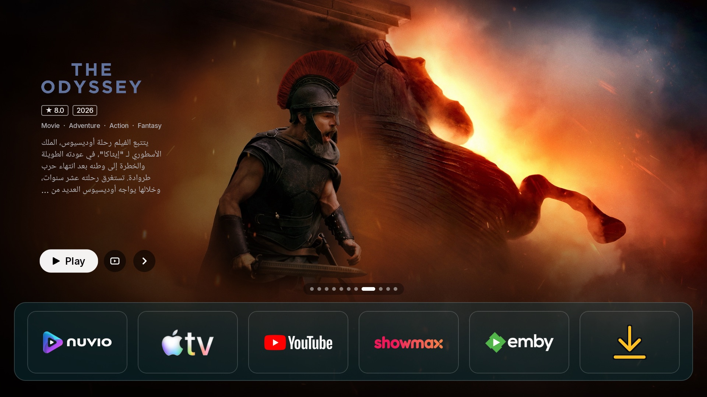 | 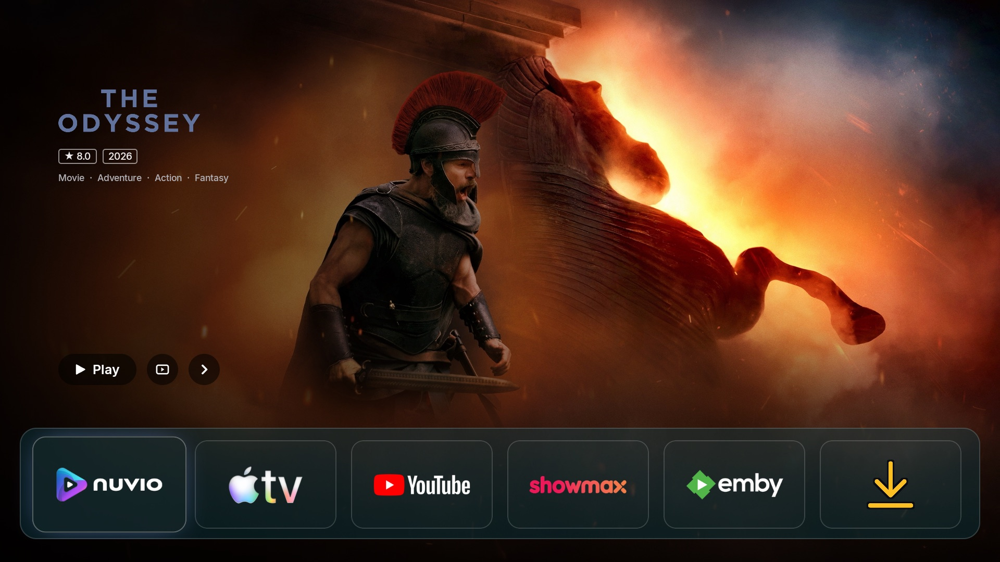 |
| 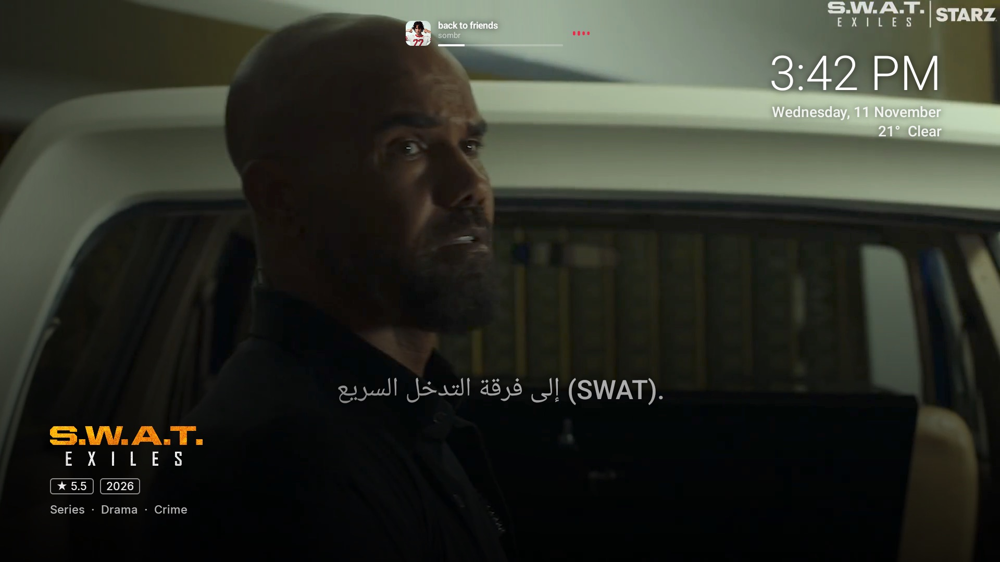 | 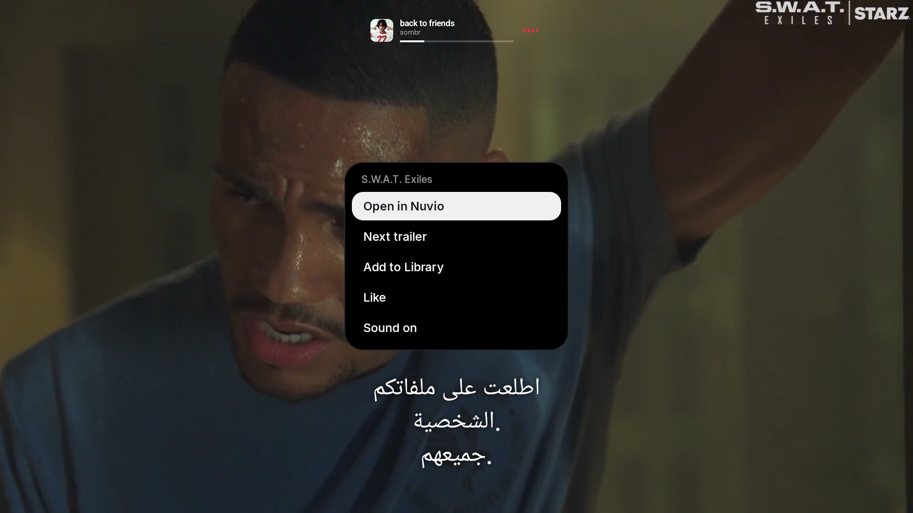 |
| 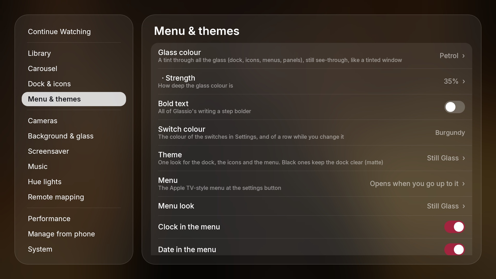 | 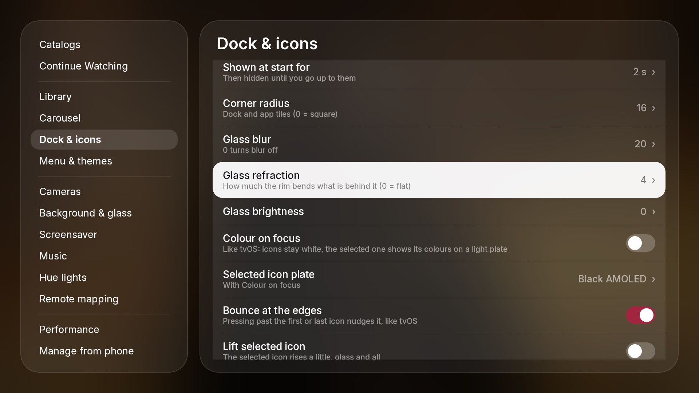 |
| 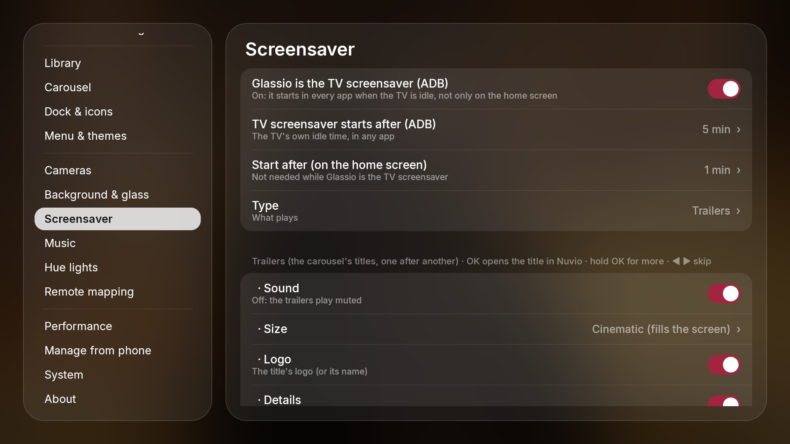 | 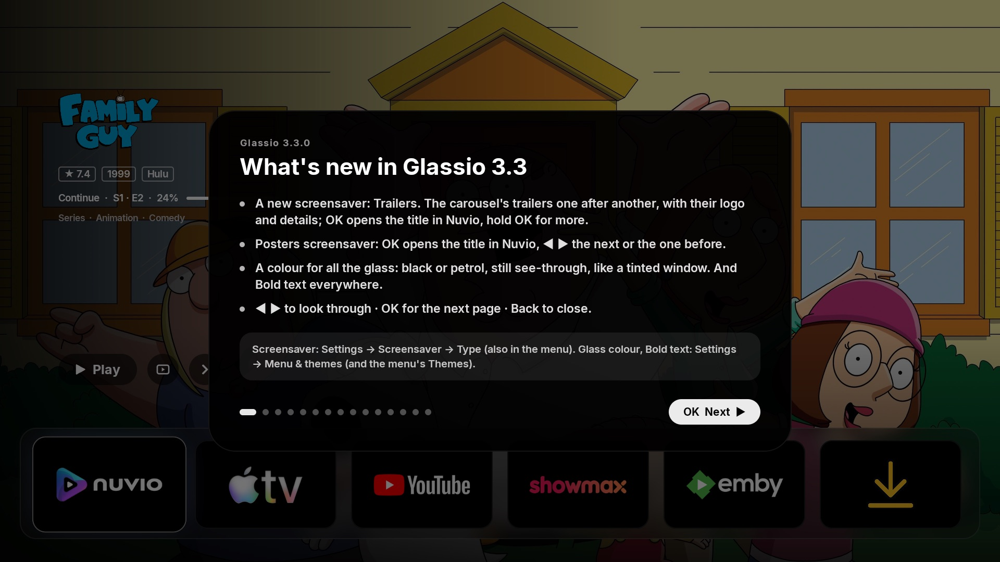 |
| 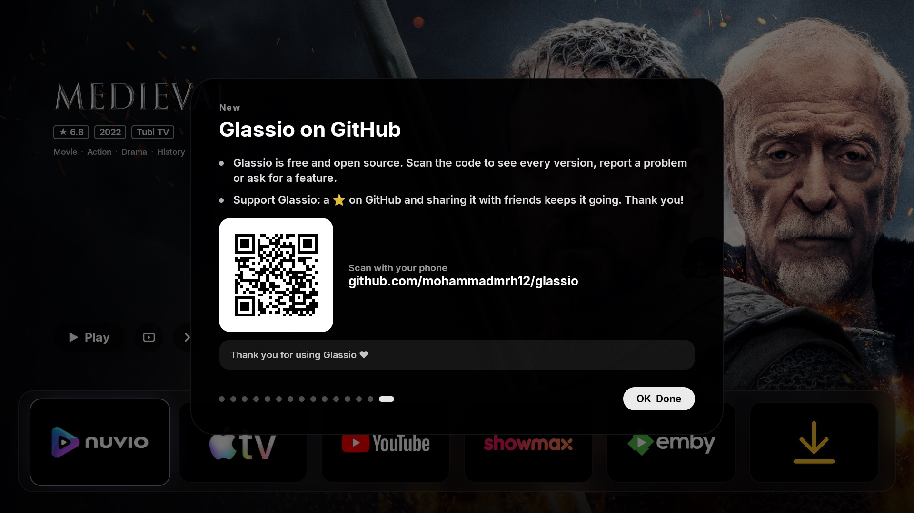 | 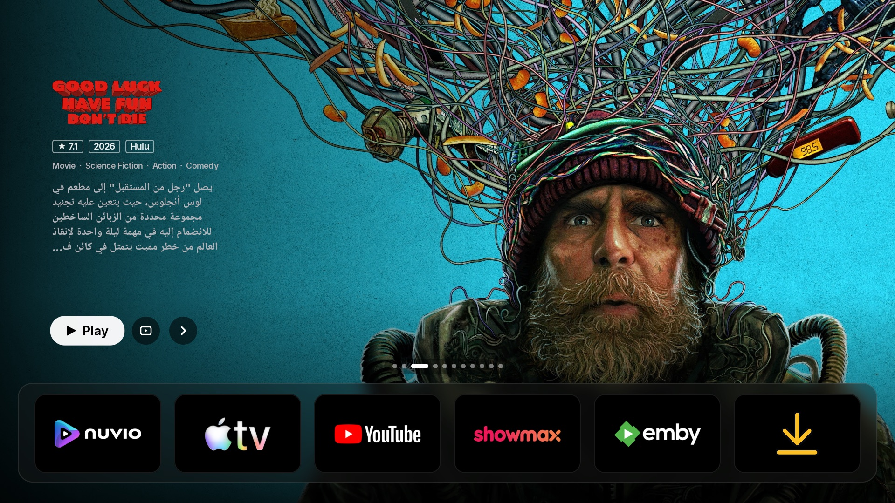 |
| 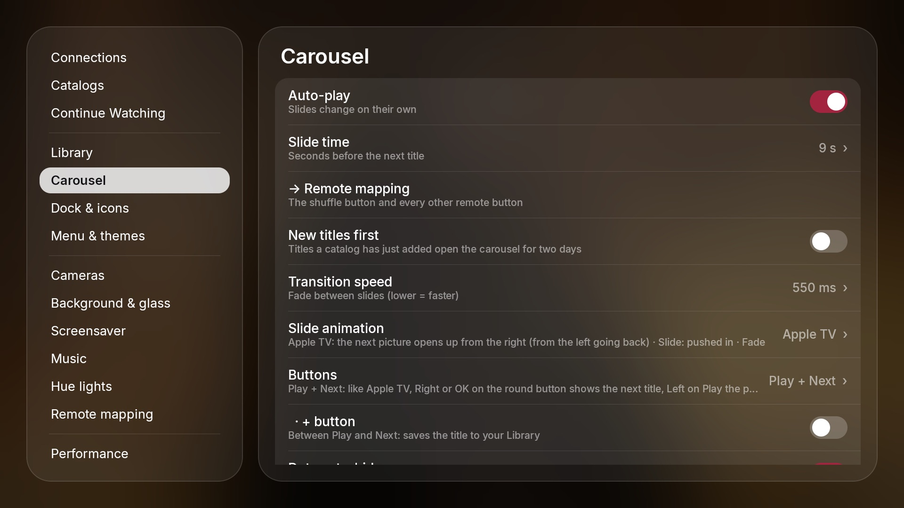 | 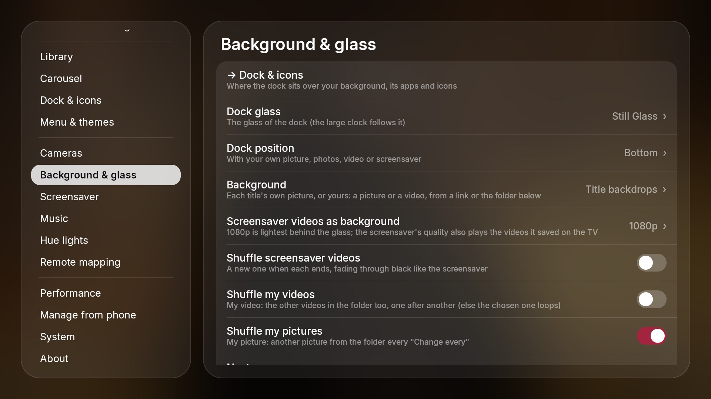 |

## 3.2.2 — Trailer fixes
- Trailers no longer stop by themselves after a few seconds, and their sound no longer plays twice: a remote
  button or Hold Home could open a second Glassio beside the home one, and both played the trailer.

## 3.2.1 — Every icon in a pack, icon search, Recent apps without USB debugging
- Icon packs now show **every icon** they include, also the ones not linked to an app — Projectivy / Blueprint style
  packs showed only part of theirs.
- **Search icons** in the icon picker (hold OK on an app → Change icon): type part of a name and every installed
  pack is searched at once.
- **Recent apps without USB debugging**: Glassio lists the apps you used lately from what its Home button service
  sees, so ADB no longer has to stay on. With USB debugging on the list is exact as before (switch: Settings →
  Remote mapping → *Recent apps use TV access*). Optional *Usage access* adds apps opened before Glassio started.

## 3.2.0 — Remote mapping
- **Remote mapping** (Settings → **Remote mapping**, #12): give any remote button an app, the **Apps folder**, the
  **recent apps** or a **TV input**; it works in any app (with the Home button service). Pressed again, the Apps folder
  and the recent apps close. Shuffle, multi-view, the corner camera, Hold Home and Back for the screensaver live here too.
- A locked app's menu (hold OK) asks for the code first; signing out of any account asks first.
- The row you change with ◀ ▶ takes the **Switch colour** (burgundy, green or purple).
- Fixed: in Music mode, opening the dock showed the carousel title behind it; the selection is always back after the
  screensaver, the Apps folder or the recent apps.

## 3.1.0 — Hue Sync, a new Settings with search, a self-hosted Nuvio
- **Hue Sync** (Settings → **Hue lights**): Philips Hue lights in the colours of what's on screen — the backdrop, the
  poster or the logo, your video background, trailers, the screensaver's videos and the music's artwork.
  - Each light follows its own part of the screen (left, right, top, corners, a gradient strip along the edges…, with
    pictures of each choice), or its place in a Hue **entertainment area**. *Blink it* shows which light is which.
  - Philips lights get colours inside their own range; other makes (Lidl Livarno, Tuya…) get hue and saturation.
  - Optional: the lights take the colour of the **app selected in the dock** or the **poster in the Library**, each with
    its own brightness.
  - Intensity, brightness, follow the picture's brightness, change speed; a new title's colours come at once.
  - When you open an app or a film, or the TV turns off: back as they were, dimmed, off or left.
- **Settings**: grouped like iPhone Settings (rounded cards, thin lines, a white selection), **search** with Glassio's
  own keyboard, quicker to open and to move through, and a **switch colour** (burgundy, green or purple).
- **Manage from phone**: redesigned like iPhone Settings, light and dark, with a search.
- **Nuvio**: a **self-hosted Nuvio backend** (server address, anon key, optional TV sign-in page) and sign-in with
  email (#11).
- **Home Assistant**: Glassio can send Nuvio's playback to Home Assistant and take pause / play / seek from it, without
  Home Assistant polling the TV.
- **Music**: the dock's Music icon opens the music page (even with Music mode off); Pause / Play show at once; names
  cross-fade in place; leaving a YouTube video keeps the music page and the selection.
- **Library**: holding Down glides at a steady pace (also with fast key repeat).
- **Cameras**: multi-view blurs everything behind it, on the home screen and the screensaver. The screensaver never
  starts during a trailer.

## 3.0.0 (and 2.0.8 – 2.0.10) — music, trailers, inputs and a new screensaver
- **What's new tour**: after an update, Glassio shows a short tour of what's new and where to switch each thing off or
  change it (Settings → About → *What's new* opens it again).
- **Music** (Settings → **Music**): Now Playing from any music app (Spotify, YouTube Music, Apple Music, Anghami,
  YouTube…).
  - **Music mode**: the home screen becomes a full-screen player with the blurred artwork, and songs cross-fade.
  - A small player in the menu (press ▶), a Music tile for the dock, and a **dynamic island** on the screensaver and the
    home screen: Up opens it with its controls, Down closes it.
  - Play, skip, **shuffle** (the same in every player) and **stop** from anywhere.
  - The island and the large clock follow your theme: black, white, frosted, clear or still glass.
- **Trailers**: a title's trailer plays in place of its picture, in Glassio's own player (no YouTube buttons, it starts
  in about a second), in **Cinematic** (fills the screen, its black bars cropped), **Original** or a small **Window**.
  - **Subtitles in your language**, translated when YouTube has none.
  - **Starts by itself** after a few seconds on a title, only while the carousel is selected (never from the dock).
  - A **Trailer** page in the menu (play / stop, starts by itself, size, dock, subtitles, sound), and **hold OK on a
    poster in the Library → Trailer**. The dock and the menus' glass follow the trailer.
- **Inputs**: the TV's HDMI inputs and HDMI-CEC devices (PlayStation, receiver…) in the menu and as dock icons.
- **Cameras**: multi-view with up to 4 cameras, Home Assistant cameras, remote buttons for multi-view and the corner
  camera.
- **Screensaver**: a large clock in your theme's glass (Up shows or hides it), hold OK to **lock** a video you like
  (*Locked only* plays just those), Down shows the cameras, and it closes smoothly through black.
- **Continue Watching** exactly as in Nuvio, with **Next Up** (the next episode of series you finished, #10), and
  *Open in* to choose the app for a Library title.
- **Smoother**: frosted glass slides as smoothly as clear glass, a faster start, a smoother carousel.

## 2.0.5 / 2.0.6 — backgrounds, a glass clock, app lock and the doorbell
- **Backgrounds** (Settings → **Background & glass**): title backdrops, **Photos in 4K** (Bing, Wikimedia Commons,
  Unsplash with a free key, or your own), **your own video**, or **the screensaver's videos**. Each has **Next** and
  **Shuffle**, fades like the screensaver and is kept in a cache that clears its oldest files. The place and credit
  can show on the background, like on the screensaver.
- **Large clock** over the background, made of the dock's glass (or white). Size, position and the **Glass blur**
  setting apply to it, and it follows a video background live.
- **Depth effect** for photos: the subject comes in front of the clock (done on the TV with a small depth model,
  only for pictures).
- **App lock**: lock any app with a 4-digit code (0000 by default). Hold OK on it → Lock. A glass code window opens it
  as soon as the code is right, with an optional hint. Only apps opened from Glassio are locked.
- **Doorbell from Home Assistant**: the camera pops up in the corner over any app, with a soft chime and your own words
  (ready-made Arabic or English). See [Doorbell](README.md#doorbell-pop-up).
- **Cameras**: *Find cameras* adds every channel of a recorder (NVR/XVR). You can choose the doorbell camera, make it go
  round your cameras, and set the size of the Hold Home camera.
- **Sharp corners** for the menus, dock and icons. New theme names: **Dynamic Glass**, **Still Glass**, **Frosted Glass**.
- Smoother glass in every theme, in step with the background, and much less memory with your own background.

## 2.0.4
- Coming back from Settings is smooth at once (the home screen and the Library are no longer rebuilt).
- **Sync** also carries removals made in Nuvio, on Trakt or on Simkl to the other accounts, and says what happened
  with each account. Glassio keeps within Simkl's daily request limit.
- Glass menus keep the remote inside them; the shuffle button works with any remote button.

## 2.0.3
- **Hold OK on Play**: a small glass menu to add the title to your Library, **Like** it (sent to Trakt and Simkl) or
  **change its artwork** from small pictures. Apps in the dock get the same glass menu.
- **Sync** (Settings → Connections): Library, likes and Continue Watching kept the same on Nuvio, Trakt and Simkl.
- **Shuffle button**: pick any remote button to shuffle the carousel; titles a catalog has just added come first.
- The corner camera can go round your cameras on its own.
- Logos appear faster, and the title's name shows when a logo is missing. Continue Watching switched off in the
  carousel stays in the Library.

## 2.0.2
- **Settings → Cameras**: everything about your cameras in one place, and you choose which camera opens when you hold
  Home and how long it stays (20 s by default).
- Back from standby, the TV opens Glassio again instead of the Google TV home.
- Screensaver videos and pictures always leave 3 GB free on the TV, and coming back from another app is faster.
- Down from Continue Watching lands on the poster right under the card.

## 2.0.1 — the Library scrolls like Apple TV
- One long, soft glide per press that keeps its speed when you hold Down, the selected row high on the page, rows
  built ahead, and a steady 60 fps on the TV (nothing is drawn under the page any more).
- Bigger focus zoom, a light shadow under every poster (deeper under the selected one), more room between rows, and
  posters loaded ahead into the cache. No more shake moving along a row, and the top of the page is never cut.
- Settings → Library: **poster size**, **posters in a row** and **space between posters**.

## 2.0.0 — smoother, faster navigation everywhere
- **Settings**: changing a look option (like *Settings background*) keeps your place and the remote stays in Settings;
  Right / OK always goes into the options (the dock behind can't take the remote any more). The section list fits
  on screen, and fast scrolling keeps the selected row steady instead of jumping.
- **Dock and Library**: opening and closing the dock is about a third lighter on the GPU, and fast Up from the
  Library stops at the dock instead of running on to the carousel and menu.

## 1.9.9
- **First-run setup**: a liquid-glass welcome — restore a backup, choose a look, sign in to Nuvio, Stremio, Trakt and
  Simkl with a QR code right there (✓ when connected), add catalogs from your phone, or *Later*.
- **Accounts in one place** (Settings → **Connections**): Nuvio, Stremio (QR or email), Trakt, Simkl (OAuth 2.0 device
  sign-in), TMDB, Home Assistant and cameras. Continue Watching from **Stremio** and **Simkl** too, catalogs from the
  Stremio account's add-ons. Removing a title here removes it in the app it came from.
- **Library**: opens with **Down from the dock** and scrolls up like Apple TV (Up from its top row goes back). A
  **Continue Watching** row with where each title came from (a dot in the app's colour), episode and progress inside
  the card — backdrop or poster shape, size. Asks before removing. Simkl *Plan to watch*.
- **Screensaver, rebuilt**: the [aerial-videos.netlify.app](https://aerial-videos.netlify.app) collections (Apple tvOS,
  Amazon Fire TV, Jetson Creative, Robin Fourcade) and your own videos, in **real 4K, HDR and Dolby Vision**, kept on the
  TV as they play. Fade between videos, shuffle or one video (with pictures of each), **◀ ▶ change the video, OK hides the
  info**. Clock, date, weather, place and TV info in **Apple** style (corner, size, how long) or **Netflix** style (lines
  one by one top left; red, white or black bar; hide when complete). Glassio can be **the TV's own screensaver** (in every
  app, via ADB); it no longer starts under another screensaver (#9).
- **Menu**: size, order (pick a row up with OK, move it with ▲ ▼), **TV info** under the weather (IP, CPU, GPU, RAM,
  storage), a **live camera** (RTSP / HLS, ONVIF search) with a LIVE badge, a screensaver page.
- **Dock**: fits fewer apps, can **hide** below the screen, sits in the **middle or as a column on the left** with your own
  background (#6), glass tiles in the open dock and the Apps folder (#8), **icon zoom** inside the glass or the whole tile,
  a soft **glow** in the app's colour or white (size adjustable).
- **Hold Home**: open apps like the Apple TV app switcher (▲ closes an app for real), a camera in the corner over any app,
  the Library or the menu.
- **Carousel**: *Surprise me* (a random mix from your catalogs, refreshed on its own), Apple-style **white logo**,
  + button toggle, **1280 enhanced** pictures, a bigger picture cache.
- **Backup and restore** of every setting, catalog, Library and account (Download/Glassio on the TV or from your phone).
  **Open Glassio when the TV starts**, **9 languages**, **Manage from phone** stays on after you leave the screen and has
  accounts, cameras and backup.
- Faster: the video background uses less than half the CPU, the dock opens and the Library scrolls at 60 fps, no logo flash
  before the screensaver, Wi-Fi coming back no longer jumps to Glassio.
- Settings reordered (Connections, Catalogs, Continue Watching, Library, Carousel, Dock, Menu, Clock & glass, Screensaver,
  Performance, Phone, System, About) with links between related sections; new defaults tuned on the Google TV Streamer.
