<p align="center"></p>

# Glassio

**An Apple TV–style home screen for Google TV / Android TV**, with real liquid glass, a carousel fed by your
Nuvio and Stremio add-on catalogs, Continue Watching from Nuvio, Stremio, Trakt and Simkl, a Library, its own 4K / HDR
aerial screensaver, tvOS-style icons, weather, cameras and Home Assistant hooks. Built with Kotlin and Jetpack Compose.
Tested on the Google TV Streamer (4K).

[العربية — دليل الاستخدام الكامل](docs/README.ar.md) · [Discussions](https://github.com/mohammadmrh12/glassio/discussions) · [Report a bug](https://github.com/mohammadmrh12/glassio/issues/new/choose) · [Contributing](CONTRIBUTING.md)

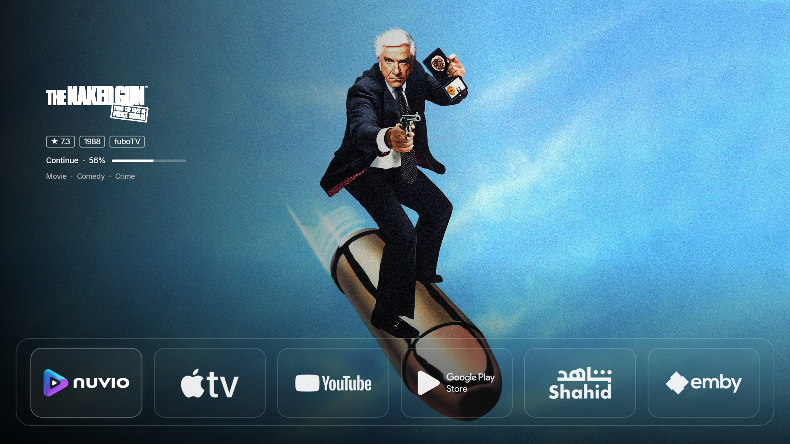

| | |
|---|---|
| 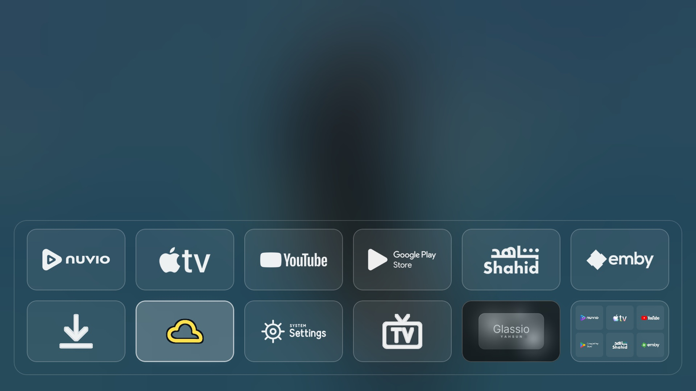 | 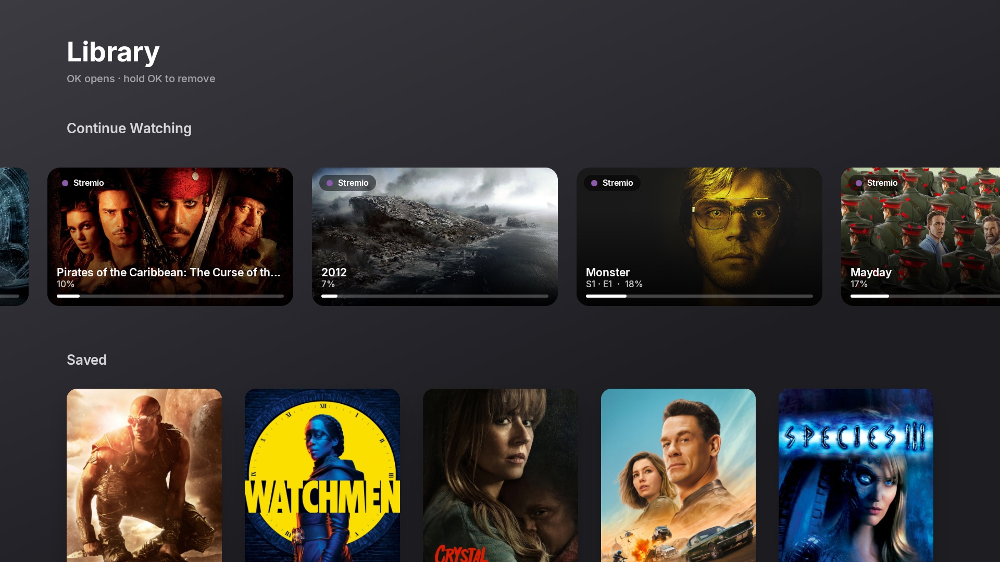 |
| 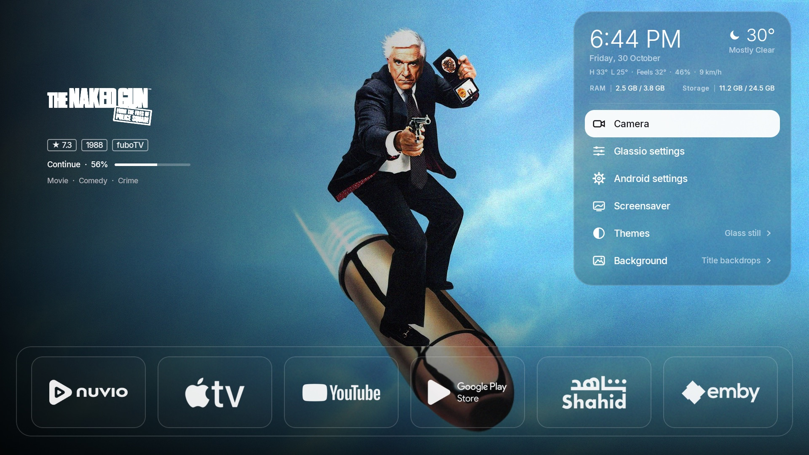 | 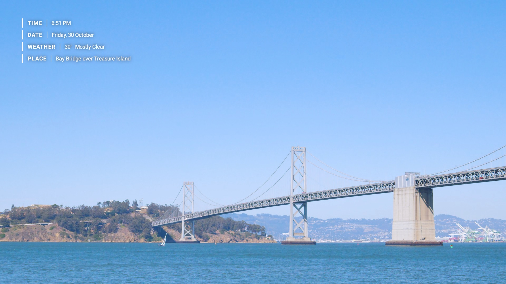 |
| 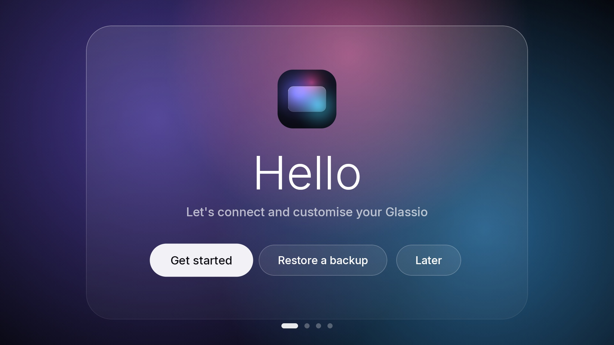 | 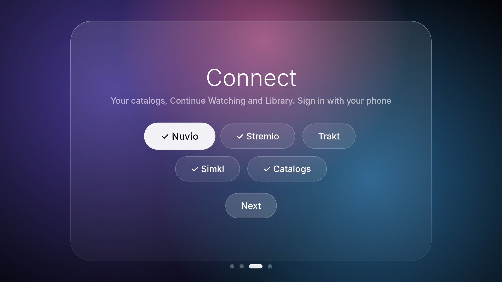 |
|  |  |
| 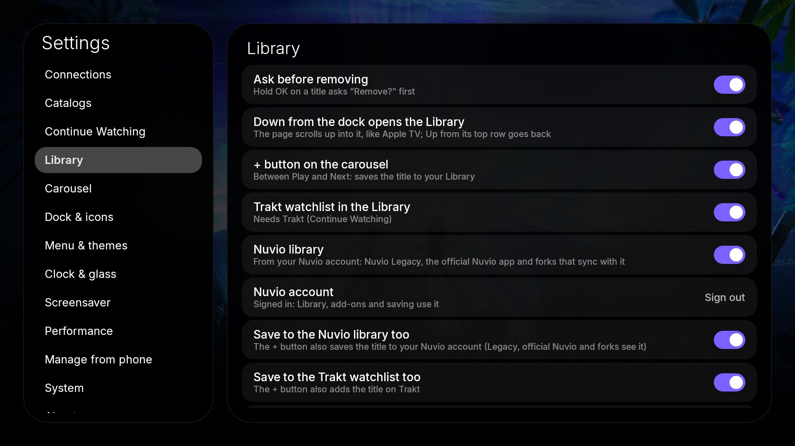 | 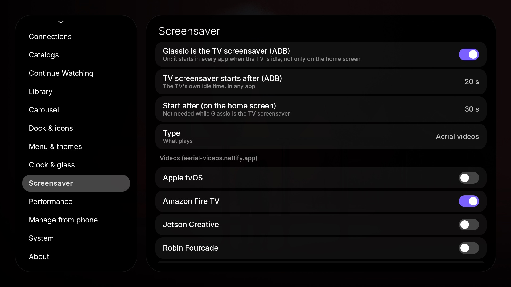 |
| 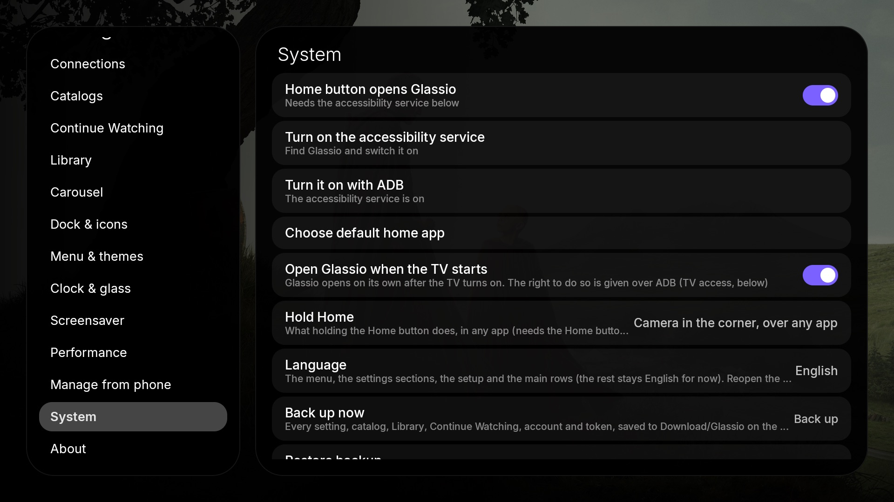 | 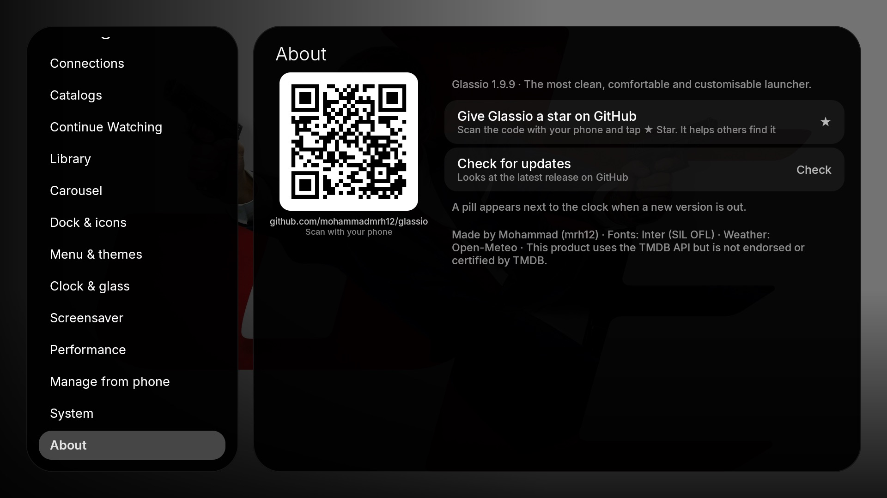 |
|  |  |

---

## Features

**New in 2.0.1** — the Library scrolls like Apple TV
- One long, soft glide per press that keeps its speed when you hold Down, the selected row high on the page, rows
  built ahead, and a steady 60 fps on the TV (nothing is drawn under the page any more).
- Bigger focus zoom, a light shadow under every poster (deeper under the selected one), more room between rows, and
  posters loaded ahead into the cache. No more shake moving along a row, and the top of the page is never cut.
- Settings → Library: **poster size**, **posters in a row** and **space between posters**.

**New in 2.0.0** — smoother, faster navigation everywhere
- **Settings**: changing a look option (like *Settings background*) keeps your place and the remote stays in Settings;
  Right / OK always goes into the options (the dock behind can't take the remote any more). The section list fits
  on screen, and fast scrolling keeps the selected row steady instead of jumping.
- **Dock and Library**: opening and closing the dock is about a third lighter on the GPU, and fast Up from the
  Library stops at the dock instead of running on to the carousel and menu.

**New in 1.9.9**
- **First-run setup**: a liquid-glass welcome — restore a backup, choose a look, sign in to Nuvio, Stremio, Trakt and
  Simkl with a QR code right there (✓ when connected), add catalogs from your phone, or *Later*.
- **Accounts in one place** (Settings → **Connections**): Nuvio, Stremio (QR or email), Trakt, Simkl (OAuth 2.0 device
  sign-in), TMDB, Home Assistant and cameras. Continue Watching from **Stremio** and **Simkl** too, catalogs from the
  Stremio account's add-ons. Removing a title here removes it in the app it came from.
- **Library**: opens with **Down from the dock** and scrolls up like Apple TV (Up from its top row goes back). A
  **Continue Watching** row with where each title came from (a dot in the app's colour), episode and progress inside
  the card — backdrop or poster shape, size. Asks before removing. Simkl *Plan to watch*.
- **Screensaver, rebuilt**: the [aerial-videos.netlify.app](https://aerial-videos.netlify.app) collections (Apple tvOS,
  Amazon Fire TV, Jetson Creative, Robin Fourcade) and your own videos, in **real 4K, HDR and Dolby Vision**, kept on the
  TV as they play. Fade between videos, shuffle or one video (with pictures of each), **◀ ▶ change the video, OK hides the
  info**. Clock, date, weather, place and TV info in **Apple** style (corner, size, how long) or **Netflix** style (lines
  one by one top left; red, white or black bar; hide when complete). Glassio can be **the TV's own screensaver** (in every
  app, via ADB); it no longer starts under another screensaver (#9).
- **Menu**: size, order (pick a row up with OK, move it with ▲ ▼), **TV info** under the weather (IP, CPU, GPU, RAM,
  storage), a **live camera** (RTSP / HLS, ONVIF search) with a LIVE badge, a screensaver page.
- **Dock**: fits fewer apps, can **hide** below the screen, sits in the **middle or as a column on the left** with your own
  background (#6), glass tiles in the open dock and the Apps folder (#8), **icon zoom** inside the glass or the whole tile,
  a soft **glow** in the app's colour or white (size adjustable).
- **Hold Home**: open apps like the Apple TV app switcher (▲ closes an app for real), a camera in the corner over any app,
  the Library or the menu.
- **Carousel**: *Surprise me* (a random mix from your catalogs, refreshed on its own), Apple-style **white logo**,
  + button toggle, **1280 enhanced** pictures, a bigger picture cache.
- **Backup and restore** of every setting, catalog, Library and account (Download/Glassio on the TV or from your phone).
  **Open Glassio when the TV starts**, **9 languages**, **Manage from phone** stays on after you leave the screen and has
  accounts, cameras and backup.
- Faster: the video background uses less than half the CPU, the dock opens and the Library scrolls at 60 fps, no logo flash
  before the screensaver, Wi-Fi coming back no longer jumps to Glassio.
- Settings reordered (Connections, Catalogs, Continue Watching, Library, Carousel, Dock, Menu, Clock & glass, Screensaver,
  Performance, Phone, System, About) with links between related sections; new defaults tuned on the Google TV Streamer.

**Carousel**
- Endless hero carousel from your Nuvio / Stremio add-on catalogs (Cinemeta, AIOMetadata, TMDB lists …), shuffled across
  all catalogs, or *Surprise me*.
- **Slide animation**: Apple TV (the next picture opens up from the side with parallax), Slide or Fade.
- **Buttons**: Play + Next (like Apple TV), Play only or Hidden, and the + button (save to the Library).
- **Dots**: dots, liquid glass drops, progress bar or hidden. Title logo (colour or white), chips, genres, synopsis.
- **Backdrop gallery** like the Apple TV app: each title shows several of its pictures before the carousel moves on.
- **Continue Watching** at the start of the carousel (1–5 slides or all) or mixed in, with progress
  (`Continue · S1 · E3 · 42%`). Back from the player, the carousel opens on what you just watched.
- Opening a title opens it directly in **Nuvio Legacy**, the **official Nuvio TV** app, **Nuvio Arc**, **Nuvio Re-Shaped**
  or **Stremio** (Settings → Connections → *Open titles in*; **Auto** picks the first installed).

**Glass**
- Real refraction (AGSL shader), a blurred backdrop shared by every glass surface, six themes: Glass still, Glass is
  glass (with ripples), Liquid, Clear, Black AMOLED, Black on white. The glass follows a video background live.

**Dock & icons**
- 6 apps per row, Apps folder with every app, move / hide / change icon / app info (hold OK).
- tvOS behaviour: colour on focus (white, dark, glass or black plate), lift, zoom, glow, rubber-band bounce at the edges.
- Icons from icon packs (Projectivy, Blueprint, Nova, ADW), a link, the TV's photos, your phone, or the **Apple TV icon
  library** (see [tools](#tools)).

**Top bar and menu**
- Clock and date, weather (Open-Meteo, no key), auto-hide. The menu at the settings button, like the Apple TV Control
  Center: clock, weather, TV info, Library, settings, Wi-Fi, themes, camera, screensaver and background — each optional.

**Home Assistant**
- Webhook when a title opens (title, type, id, app). See [Home Assistant](#home-assistant).

**Updates**
- Checks GitHub Releases, shows a pill next to the clock; it downloads and installs right there (silently through the TV's
  adb, or with Android's installer).

**Performance**
- Auto picks the light preset on weak TVs (2 GB, old graphics); every option can be changed on its own. Animations read
  in the draw and layout phases, cached GPU layers, baseline profiles, R8.

---

## Install

1. Download `Glassio-x.y.z.apk` from [Releases](https://github.com/mohammadmrh12/glassio/releases).
2. Install it on the TV: with the **Downloader** app (enter the release link), a USB stick, or from a computer:
   ```sh
   adb connect <tv-ip>:5555
   adb install -r Glassio-x.y.z.apk
   ```
3. Open **Glassio** from the TV's apps. The first time, the setup walks you through accounts, catalogs and the look.

### Make it your home screen (Home button)

Google TV always sends the Home button to its own launcher, so Glass uses an accessibility service to catch it.

1. Settings → **System** → *Turn on the accessibility service* → choose **Glassio** → On.
2. Recommended — so Android keeps the service on after updates, and so Glass can start the TV screensaver and read Nuvio's
   progress, run once from a computer:
   ```sh
   adb shell pm grant com.glasslauncher.tv android.permission.WRITE_SECURE_SETTINGS
   ```
3. The first time Glass uses the TV's own adb (TV screensaver, Continue Watching, silent updates) the TV asks
   **"Allow USB debugging?"** for Glassio: tick **Always allow** and choose **Allow**. *Network debugging* must be
   on (Settings → System → Developer options).

---

## Setup

### Catalogs (Nuvio add-ons)
- **Settings → Catalogs → Add add-ons from my phone (QR)**: scan the code with your phone (same Wi-Fi), paste manifest
  links (`https://…/manifest.json`) and, optionally, your TMDB token.
- Or **Connect to Nuvio**: in Nuvio open *Add-ons → Manage from phone* first, then press Connect.
- Choose the catalogs you want; *Refresh catalogs* reloads them.

### TMDB token (logos, full-size art, synopsis language, ratings, gallery)
1. Create a free account at [themoviedb.org](https://www.themoviedb.org/) → Settings → API → copy the **API Read Access Token**.
2. Settings → Catalogs → **TMDB token** (or paste it on the phone page).
3. Settings → Carousel → **Synopsis language**: 24 languages (English, Arabic, French, Spanish, German, Italian,
   Portuguese, Turkish, Russian, Persian, Hindi, Japanese, Korean, Chinese …). English is used when a title has no text in that language.

### Continue Watching
- Works with **Nuvio Legacy**: Nuvio Legacy writes what you play (title, episode, how far) to the TV's log, and Glassio
  reads that log through the TV's own debugging connection (ADB, see below). Nothing leaves the TV.
- **Trakt**: Settings → Continue Watching → *Connect Trakt account* shows a short code; enter it at trakt.tv/activate on
  your phone (no password on the TV). What you pause in any app that scrobbles to Trakt — the official Nuvio app,
  Nuvio Arc, Re-Shaped, Stremio, Kodi… — then shows up too (synced every few minutes and when you come back to Glassio).
  Removing a Trakt title here removes it on Trakt as well.
- The official Nuvio app, Nuvio Arc and Re-Shaped don't write the Legacy log, so for them use Trakt. Other apps (Netflix, YouTube…) keep their Continue Watching private on Google TV.
- Settings → **Continue Watching**: at the start / mixed / off, how many slides lead, open on what you just watched, progress bar, clear the list.
- A title leaves the list when you finish it (past 92 %) or remove it.

### TV access (ADB) — one-time setup
Continue Watching from Nuvio Legacy, Glassio as the TV screensaver, TV info (CPU / GPU), open apps, starting with the TV
and silent updates use the TV's own
debugging connection (Glassio talks to it on the TV itself, like Nuvio TV Relay). Settings → **System** walks you through it:
1. **Open About** → press OK on *Android TV OS build* (or *Build*) **7 times** until it says you are a developer.
2. **Open Developer options** → turn on **USB debugging** (on some TVs also *Network debugging* / *ADB over network*).
3. **Allow Glassio** → the TV asks *Allow USB debugging?* → tick **Always allow from this computer** → OK. Asked only once.
The rows show what is already done (Developer options on, USB debugging on, Glassio allowed).

### Icons
**One app**
- On the home screen, hold **OK** on the app → **Change icon**, then pick from:
  Suggested, the Apple TV icons (default / dark / white / clear), any installed icon pack,
  a photo saved on the TV, a link to a PNG, your phone (Settings → Manage from phone), or back to the original.

**Icon packs (all apps at once)**
1. Install an Android TV / Projectivy icon pack from Google Play
   (Settings → Dock & icons → *Find icon packs on Google Play* opens the search). ADW / Nova / Blueprint packs work too.
2. Settings → Dock & icons → **Icon pack** → choose it. Every app takes the pack's icon; single apps can still be changed.

**Many icons from files**
- Copy `<package>.png` files (for example `com.netflix.ninja.png`) into the icon folder shown in
  Settings → Dock & icons, then press **Import icons from the icon folder**.

**Apps folder**: Settings → Dock & icons → *Show Apps folder* (or hold OK on the folder → *Hide from the dock*).

Look: Settings → Dock & icons (dock size, dock and settings background, icon style) and
Settings → Clock & glass (colour on focus, plate light/dark, bounce, lift).

### Weather
Settings → Clock & glass → **Weather** (everything / temperature + sky / temperature + city / temperature / off),
**Weather city** (English or Arabic name; the place found is shown next to it), Fahrenheit.

### Screensaver
Settings → **Screensaver**:
1. *Type*: **Aerial videos** (default), posters with logos, or the TV's own screensaver app.
2. Turn on the collections you like (Apple tvOS, Amazon Fire TV, Jetson Creative, Robin Fourcade) and/or **My videos**
   (your links and the videos in the backgrounds folder; upload them from your phone). *Quality*: 1080p H.264, 1080p HEVC,
   4K, 1080p HDR, 4K HDR / Dolby Vision — videos without that quality play the nearest one.
3. **Glassio is the TV screensaver (ADB)**: it then starts in every app when the TV is idle, after *TV screensaver starts
   after*. Otherwise *Start after* sets the idle time on the home screen.
4. *Keep videos on the TV* saves each video as it plays (up to the space you choose), so it starts at once next time.
5. While it plays: **◀ ▶** change the video, **OK** shows or hides the info, any other key ends it.

### Performance
Settings → **Performance** → *Mode*: **Auto** (default: picked for the TV from its memory and graphics chip,
e.g. a 2 GB TCL gets Performance, a Google TV Streamer gets Balanced), *Performance*, *Balanced*, *Quality*.
Each setting can be changed on its own (the mode then shows *Custom*):
- **Glass detail**: resolution of the picture the glass bends (480 px, or 720 px for crisper glass).
- Picture quality, prepare ahead, slide transition, glass refraction, backdrop gallery.

The clear dock and tiles show the page picture itself (half screen resolution), so the glass lines up with the
backdrop and stays sharp at any *Glass detail*.

In Settings, rows changed with ◀ ▶ (and app order) only change after you press **OK** on them; OK or Back
again when done. Moving down the list never changes a value by accident.

### Artwork
Settings → Carousel → **Artwork**: Main (TMDB), Second picture, Highest resolution, or the add-on's own picture.
For one title: on the carousel **hold OK** (or press Menu) to switch to its next picture; Glassio remembers it
(*Reset pictures picked per title* undoes all of them).

---

## Home Assistant

Glass posts JSON to a Home Assistant **webhook** every time you open a title from the carousel:

```json
{ "event": "launch", "title": "Severance", "type": "series", "id": "tt11280740", "app": "space.nuvio.nativelegacy" }
```

**1. Create the automation** (Settings → Automations → Create → Edit in YAML):

```yaml
alias: Glassio – title opened
mode: queued
triggers:
  - trigger: webhook
    webhook_id: glass_launcher_CHANGE_ME   # pick a long random id
    allowed_methods: [POST]
    local_only: true
actions:
  # Re-fire as an event other automations can use
  - event: glass_launcher
    event_data:
      title: "{{ trigger.json.title }}"
      type: "{{ trigger.json.type }}"
      id: "{{ trigger.json.id }}"
  # Example: movie time
  - if: "{{ trigger.json.event == 'launch' }}"
    then:
      - action: light.turn_off
        target: { area_id: living_room }
```

**2. Give Glass the URL**: `http://<home-assistant-ip>:8123/api/webhook/glass_launcher_CHANGE_ME`
- Settings → **Connections → Home Assistant webhook**, or paste it on the phone page (Settings → *Manage from phone*).
- Turn on **Tell Home Assistant when a title opens**, then **Send a test event** (sends `{"event":"test"}`).

Use the IP address of Home Assistant (the TV may not resolve `homeassistant.local`). `local_only: true` keeps the webhook
on your home network.

---

## Updates
Glass checks this repository's latest release at start and every 12 hours. An **Update x.y.z** pill appears next to the
clock with a small banner of what's new: go up to it and press **OK** to download and install right there (or Settings →
**About → Install update**). With "Allow USB debugging" accepted, the update is
silent and Glass reopens by itself; otherwise Android asks you to confirm (allow *Install unknown apps* for Glassio).

Releases are signed with the same key, so they install over each other.

---

## Troubleshooting
- Everything that fails quietly (network, Trakt, the TV's adb, opening a title in Nuvio) is logged under one tag:
  `adb logcat -s Glassio`.
- Settings snapshot: see *Testing from a computer* in [CONTRIBUTING.md](CONTRIBUTING.md) (`--ez dump_prefs true`, then `adb logcat -s GlassPrefs`).
- Continue Watching from Nuvio Legacy, Glassio as the TV screensaver, open apps and silent updates need TV access (ADB): Settings → System.
- Stuck somewhere? Settings → System → **Back up now** keeps everything; *Restore backup* brings it back after a reinstall.

## Tools
- `tools/appletv_icons.py <out>` — builds the Apple TV icon library from Apple's public iTunes Search API (the tvOS
  home-screen icon of each app, 1280×768) and renders dark / white / clear looks. The icons belong to their owners and are
  not included in this repository.
- `TV=<tv-ip>:5555 tools/push_appletv_icons.sh <out>` — copies the library to the TV
  (`Android/data/com.glasslauncher.tv/files/appletv/`).
- `tools/framestats.py` — summarises `adb shell dumpsys gfxinfo com.glasslauncher.tv framestats` per frame stage.

Terminal helpers (`adb shell am start -n com.glasslauncher.tv/.MainActivity …`): `--ez open_folder true`,
`--ei open_settings <tab>`, `--ez open_menu true`, `--ez open_library true`, `--ez start_saver true`. Changing settings
from a computer needs the dev key (so other apps can't): see [CONTRIBUTING.md](CONTRIBUTING.md#testing-from-a-computer).

## Build
```sh
export JAVA_HOME=/path/to/jdk-17
export ANDROID_HOME=/path/to/android-sdk
./gradlew assembleRelease     # app/build/outputs/apk/release/app-release.apk
```

## Privacy & security
- No accounts, analytics or ads. Settings stay on the TV (`allowBackup=false`).
- The phone page runs while its screen is open (and for the time you choose after), and every request needs the one-time
  token in its QR code. Changing settings from a computer needs a dev key only adb can read.
- Backups contain your sign-ins: keep the file private.
- Webhook, TMDB token and add-on links are only sent where you point them.
- The TV's adb is used only for: the screensaver settings, reading Nuvio Legacy's playback log, TV info (CPU / GPU), open
  apps, starting with the TV and installing Glassio updates.

## Credits
Inter typeface (SIL Open Font License) · Weather by [Open-Meteo](https://open-meteo.com) · Catalog data from your Nuvio add-ons ·
This product uses the TMDB API but is not endorsed or certified by TMDB. · Not affiliated with Apple, Google or Nuvio.

## Copyright, name and license
Copyright (C) 2026 mohammad (mrh12).

Glassio is free software under the [GNU General Public License v3.0](LICENSE) (GPL-3.0), the same license as Nuvio.
You may use, study, change and share the code under GPL-3.0. If you distribute a modified version, you must comply with the license, including its applicable source-code and notice requirements.

The GPL-3.0 license grants rights to the code; it does not automatically grant permission to use the Glassio name or logo in a way that suggests an independent build is an official release. See [TRADEMARKS.md](TRADEMARKS.md).
