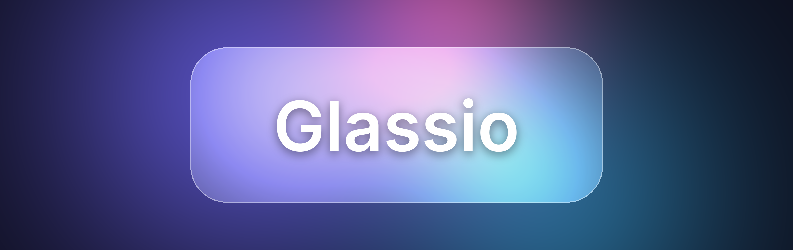
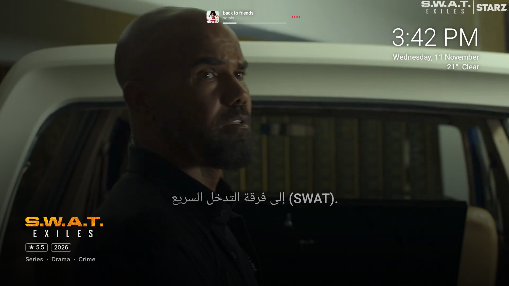
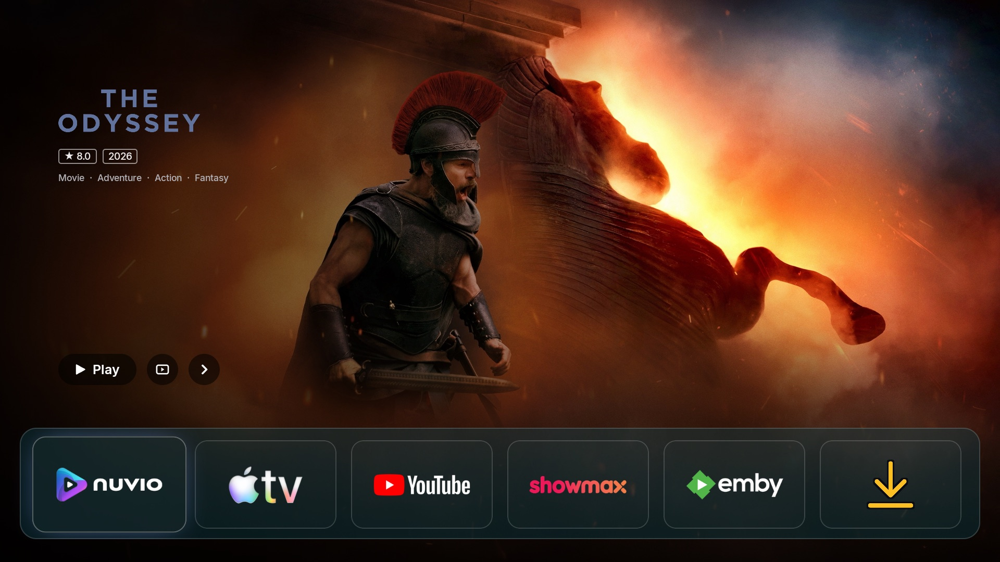
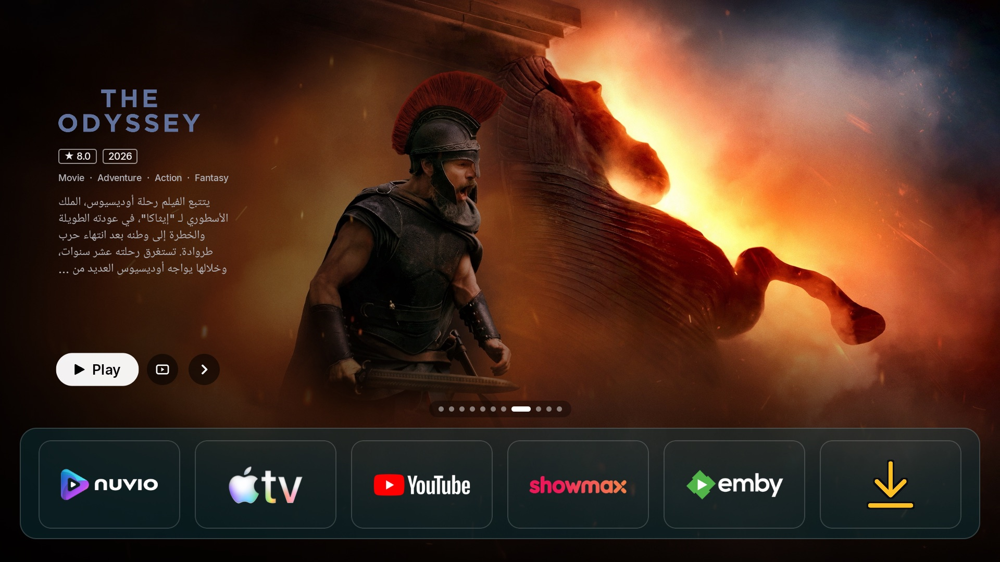
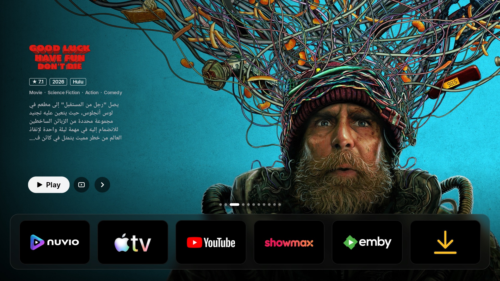
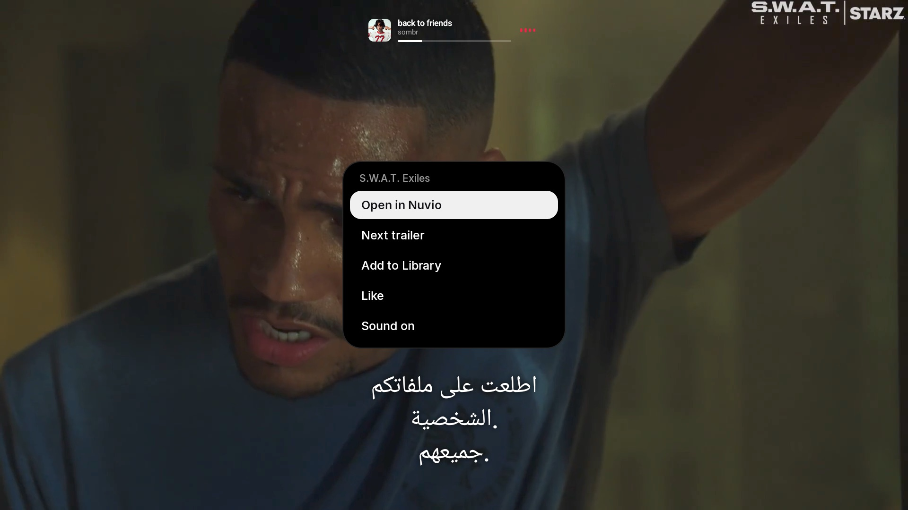
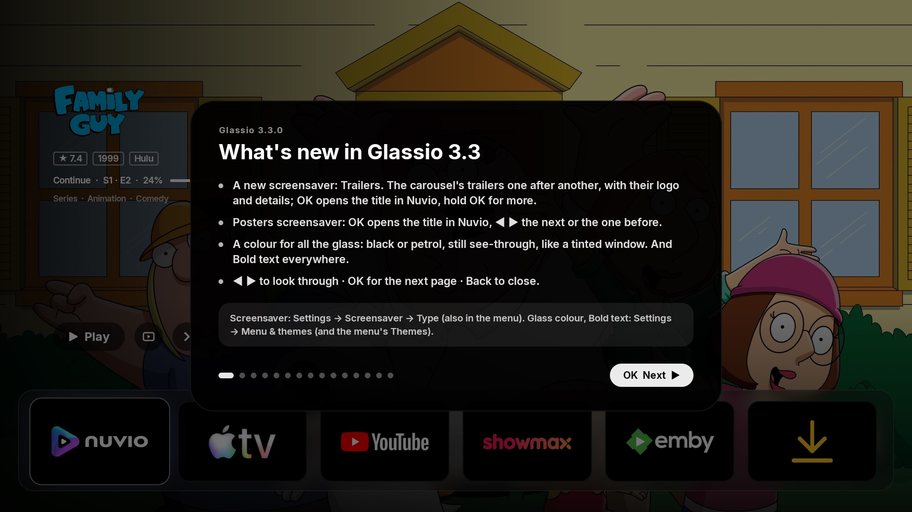

<p align="center">
  <a href="https://www.reddit.com/r/glassio_/"></a>
  <a href="https://github.com/mohammadmrh12/glassio/releases/latest"></a>
  <a href="https://github.com/mohammadmrh12/glassio/discussions"></a>
</p>

**An Apple TV–style home screen for Google TV / Android TV**: real liquid glass, a carousel of your Nuvio and Stremio
catalogs with trailers, each app's channels, music mode, Continue Watching from Nuvio, Stremio, Trakt and Simkl, a 4K /
HDR screensaver, Hue lights, cameras, Home Assistant, and sync between your TVs. Built with Kotlin and Jetpack Compose.
Tested on the Google TV Streamer (4K).

[العربية — دليل الاستخدام الكامل](docs/README.ar.md) · [Discussions](https://github.com/mohammadmrh12/glassio/discussions) · [Report a bug](https://github.com/mohammadmrh12/glassio/issues/new/choose) · [Contributing](CONTRIBUTING.md) · [Changelog](CHANGELOG.md)


| | |
|---|---|
|  |  |
|  |  |
|  |  |
|  |  |
|  |  |
|  |  |
|  |  |
|  |  |

---

## Features

Latest: **3.6.0** — sync between your TVs, Nuvio profiles, a new settings button. What changed in every version:
[CHANGELOG](CHANGELOG.md).

- **Home screen** — an endless carousel from your Nuvio / Stremio catalogs with trailers (subtitles in your language),
  logos, backdrop galleries and Continue Watching; opens titles in Nuvio or Stremio.
- **Liquid glass** — real refraction, six themes, a glass colour (black or petrol), bold text, round or sharp corners.
- **Dock & icons** — tvOS-style focus, glow and bounce, icon packs and the Apple TV icon library, an Apps folder, app lock.
- **Channels** — select YouTube, Shahid, Netflix… in the dock and its rows take the carousel's place.
- **Music** — Now Playing from any music app: a full-screen music mode, a dynamic island and the Music icon.
- **Library & accounts** — Continue Watching and lists from Nuvio (any profile), Stremio, Trakt and Simkl, kept in step.
- **Screensaver** — 4K / HDR / Dolby Vision aerials, trailers or posters, with the clock and info in Apple or Netflix style.
- **Backgrounds** — 4K photos, your own picture or video, a large glass clock with a depth effect.
- **Sync between TVs** — one main TV, the others follow it live over your home network; each chooses what it takes.
- **Smart home** — Hue lights that follow the screen, cameras and multi-view, a doorbell pop-up, Home Assistant.
- **TV & remote** — HDMI inputs, any remote button mapped, the Hold Home app switcher and recent apps.
- **Menu** — a Control Center at the settings button: weather, TV info, a camera, inputs, themes, music.
- **Easy to live with** — first-run setup with QR sign-ins, backup and restore, managing from your phone, 9 languages,
  updates from GitHub, performance presets for weaker TVs.

---

## Get started

| | |
|:--:|---|
| **1 · Download** | Get `Glassio-x.y.z.apk` from **[the latest release](https://github.com/mohammadmrh12/glassio/releases/latest)**. |
| **2 · Install** | With the **Downloader** app (type the release link), a USB stick, or from a computer: `adb install -r Glassio-x.y.z.apk` |
| **3 · Open** | Open **Glassio** from the TV's apps. A short setup walks you through accounts, catalogs and the look. |

### Make Glassio your Home button

Google TV always sends Home to its own launcher, so Glassio catches it with an accessibility service.

1. Settings → **System** → *Turn on the accessibility service* → **Glassio** → On.
2. Once, from a computer — keeps the service on after updates and lets Glassio run the TV screensaver:
   ```sh
   adb shell pm grant com.glasslauncher.tv android.permission.WRITE_SECURE_SETTINGS
   ```
3. The first time Glassio uses the TV's own adb, the TV asks **"Allow USB debugging?"** — tick **Always allow**, then **Allow**.

> [!TIP]
> Moving from another TV? Settings → **System → Back up now** there, then *Restore backup* in the setup here.
> Or keep both TVs the same with **Settings → Sync**.

---

## Setup guides

Tap a guide to open it. Every path starts in Glassio's **Settings** (the button at the top of the home screen).

<details>
<summary><b>📚 Catalogs</b> — fill the carousel from your Nuvio / Stremio add-ons</summary>

- **Catalogs → Add add-ons from my phone (QR)**: scan the code (same Wi-Fi) and paste manifest links
  (`https://…/manifest.json`) and, if you like, your TMDB token.
- Or **Connections → Nuvio / Stremio**: sign in and the account's add-ons come with it.
- Pick the catalogs you want; *Refresh catalogs* reloads them. Titles open in Nuvio Legacy, the official Nuvio app,
  Nuvio Arc, Re-Shaped or Stremio (*Connections → Open titles in*, **Auto** picks the first installed).
</details>

<details>
<summary><b>🎬 TMDB token</b> — logos, full-size pictures, ratings and the synopsis in your language</summary>

1. Make a free account at [themoviedb.org](https://www.themoviedb.org/) → Settings → API → copy the **API Read Access Token**
   (the long one starting `eyJ…`).
2. Paste it in **Connections → TMDB token** (easier from *Manage from phone*).
3. **Carousel → Synopsis language**: 24 languages; English when a title has none in yours.
</details>

<details>
<summary><b>⏯️ Continue Watching</b> — from Nuvio, Stremio, Trakt and Simkl</summary>

- **Connections**: sign in to Nuvio, Stremio, Trakt or Simkl with a code or QR on your phone — no password on the TV.
  Nuvio can use any of the account's profiles.
- **Nuvio Legacy** without an account: Glassio reads what it plays from the TV itself (needs *TV access*, below).
- **Continue Watching** settings: where it shows in the carousel, how many slides lead, Next Up, progress, clearing the list.
- A title leaves the list when you finish it or remove it — removing it here removes it where it came from.
</details>

<details>
<summary><b>🔓 TV access (ADB)</b> — one time, for the TV screensaver, Nuvio Legacy, recent apps and silent updates</summary>

**System** walks you through it; each row shows what's already done:
1. **Open About** → press OK on *Android TV OS build* **7 times** (you're now a developer).
2. **Open Developer options** → turn on **USB debugging** (some TVs: *Network debugging*).
3. **Allow Glassio** → tick **Always allow from this computer** → OK. Asked only once.

Glassio talks to the TV's adb on the TV itself; nothing leaves your home.
</details>

<details>
<summary><b>🧩 Icons</b> — icon packs, the Apple TV library, or one app at a time</summary>

- **One app**: on the home screen hold **OK** on it → **Change icon**: suggested, Apple TV icons, any icon pack (with
  search), a photo on the TV, a link, your phone, or the original.
- **Every app at once**: install a Projectivy / ADW / Nova / Blueprint pack, then **Dock & icons → Icon pack**.
- **Many from files**: put `<package>.png` files (e.g. `com.netflix.ninja.png`) in the icon folder shown in
  **Dock & icons**, then *Import icons from the icon folder*.
- The look — colour on focus, plate, glow, lift, bounce, the Apps folder — is all in **Dock & icons**.
</details>

<details>
<summary><b>📺 Sync between your TVs</b> — one main TV, the others follow it</summary>

1. On the main TV: **Sync → This TV → Main TV**, then **Add a TV** shows a 4-digit code.
2. On the other TV: **Sync → This TV → Follows another TV**, pick the main TV and type the code.
3. Choose what it takes (look, dock, home screen, channels, screensaver, add-ons, library) and **Automatic** or **Manual**.

Keys, Hue, cameras, remote buttons and the app lock move only if you turn them on. Sign-ins never move — sign in on each TV.
</details>

<details>
<summary><b>💡 Hue lights</b> — your lights in the colours of the screen</summary>

**Hue lights**: find the bridge and press its button, then give each light a part of the screen (or use a Hue
entertainment area). *Blink it* shows which light is which. Choose what they follow — the picture, trailers, the
screensaver, music — and what happens when you open an app or the TV turns off.
</details>

<details>
<summary><b>🌌 Screensaver</b> — 4K / HDR aerials, trailers or posters</summary>

1. **Screensaver → Type**: aerial videos, posters with logos, trailers, or the TV's own screensaver app.
2. Pick collections (Apple tvOS, Amazon Fire TV, Jetson Creative, Robin Fourcade) and/or **My videos**, and the
   *Quality*: 1080p H.264 / HEVC, 4K, HDR, Dolby Vision.
3. **Glassio is the TV screensaver (ADB)** starts it in every app when the TV is idle.
4. While it plays: **◀ ▶** change the video, **OK** shows or hides the info, hold **OK** to keep a video you like.
</details>

<details>
<summary><b>☀️ Weather, artwork and performance</b></summary>

- **Weather**: Background & glass → *Weather* and *Weather city* (English or Arabic), Fahrenheit. Free, no key.
- **Artwork**: Carousel → *Artwork* (main, second picture, highest resolution, the add-on's). Hold OK on the carousel
  to switch one title's picture; Glassio remembers it.
- **Performance → Mode**: **Auto** picks for the TV (a 2 GB TCL gets *Performance*, a Google TV Streamer *Balanced*);
  every option can be changed on its own (*Custom*).
</details>

---

## Home Assistant

Glassio and Home Assistant work both ways:

| | |
|---|---|
| 🎬 **A title opens** | Glassio posts it to a webhook — dim the lights for a film. |
| ▶️ **Nuvio playback** | What plays in Nuvio is sent to Home Assistant, and pause / play / seek come back. |
| 🔔 **The doorbell rings** | Its camera pops up in the corner over any app, with a chime and your words. |
| 📷 **Cameras** | Any camera Home Assistant shows, in the menu, the corner or multi-view. |

<details>
<summary><b>Webhook: when a title opens</b></summary>

Every title opened from the carousel sends:

```json
{ "event": "launch", "title": "Severance", "type": "series", "id": "tt11280740", "app": "space.nuvio.nativelegacy" }
```

**1. The automation** (Settings → Automations → Create → Edit in YAML):

```yaml
alias: Glassio – title opened
mode: queued
triggers:
  - trigger: webhook
    webhook_id: glass_launcher_CHANGE_ME   # pick a long random id
    allowed_methods: [POST]
    local_only: true
actions:
  - event: glass_launcher          # re-fired for your other automations
    event_data:
      title: "{{ trigger.json.title }}"
      type: "{{ trigger.json.type }}"
      id: "{{ trigger.json.id }}"
  - if: "{{ trigger.json.event == 'launch' }}"
    then:
      - action: light.turn_off
        target: { area_id: living_room }
```

**2. In Glassio**: Connections → **Home Assistant webhook** →
`http://<home-assistant-ip>:8123/api/webhook/glass_launcher_CHANGE_ME`, turn on *Tell Home Assistant when a title opens*,
then *Send a test event*. Use Home Assistant's IP address (the TV may not find `homeassistant.local`).
</details>

<a id="doorbell-pop-up"></a>
<details>
<summary><b>Doorbell pop-up</b></summary>

Settings → **Cameras → Doorbell pop-up**. **Try it** shows it straight away.

**Easiest, no automation**: under *Straight from Home Assistant* add the Home Assistant link, a **long-lived access token**
(your profile → Security) and pick the **doorbell sensor**. Glassio watches it itself.

**Or from an automation** — the same request PiPup takes:

```yaml
# configuration.yaml
rest_command:
  glassio_doorbell:
    url: "http://<tv-ip>:7979/notify"
    method: POST
    content_type: "application/json"
    payload: '{"camera": "Front door", "duration": 30, "title": "Front Door", "message": "Someone is at the door"}'
```

Call `rest_command.glassio_doorbell` when the doorbell rings. `camera` is one of your cameras in Glassio (or send
`video_url`); everything is optional. Keep port 7979 on your home network.
</details>

---

## Updates

Glassio checks for a new release when it starts and every 12 hours. An **Update** pill appears next to the clock: press
**OK** on it and it downloads and installs right there (or **About → Install update**). With TV access it's silent and
Glassio reopens by itself. Every release is signed with the same key, so it installs over the last one and keeps your settings.

## Something wrong?

| | |
|---|---|
| **Home goes to Google TV** | System → turn the accessibility service on, and run the `pm grant` line above once. |
| **No Continue Watching from Nuvio Legacy** | Finish *TV access (ADB)* in System. |
| **Catalogs stay empty** | Catalogs → *Refresh catalogs*; check each add-on link opens on your phone. |
| **Reinstalling** | System → **Back up now** first; *Restore backup* brings everything back. |
| **Still stuck** | [Open an issue](https://github.com/mohammadmrh12/glassio/issues/new/choose) with `adb logcat -s Glassio`, or ask on [Reddit](https://www.reddit.com/r/glassio_/). |

---

## For developers

<details>
<summary><b>Build</b></summary>

```sh
export JAVA_HOME=/path/to/jdk-17
export ANDROID_HOME=/path/to/android-sdk
./gradlew assembleRelease     # app/build/outputs/apk/release/app-release.apk
```
See [CONTRIBUTING.md](CONTRIBUTING.md) for testing from a computer and the settings snapshot (`--ez dump_prefs true`).
</details>

<details>
<summary><b>Tools and terminal helpers</b></summary>

- `tools/appletv_icons.py <out>` — builds the Apple TV icon library from Apple's public iTunes Search API (each app's tvOS
  icon, 1280×768) in default / dark / white / clear. The icons belong to their owners and aren't in this repository.
- `TV=<tv-ip>:5555 tools/push_appletv_icons.sh <out>` — copies it to the TV (`Android/data/com.glasslauncher.tv/files/appletv/`).
- `tools/framestats.py` — sums up `adb shell dumpsys gfxinfo com.glasslauncher.tv framestats` per frame stage.
- `adb shell am start -n com.glasslauncher.tv/.MainActivity` with `--ez open_folder true`, `--ei open_settings <tab>`,
  `--ez open_menu true`, `--ez open_library true`, `--ez start_saver true` or `--ez show_tour true`. Changing settings
  from a computer needs the dev key ([CONTRIBUTING.md](CONTRIBUTING.md#testing-from-a-computer)).
</details>

---

## Privacy & security

- 🚫 No accounts of ours, no analytics, no ads. Settings stay on the TV.
- 📱 The phone page only runs while you use it, and every request needs the one-time token in its QR code.
- 🔑 Backups hold your sign-ins — keep the file private. Sync never sends sign-ins, and talks only to TVs you paired.
- 🏠 The webhook, TMDB token and add-on links go only where you point them. The TV's adb is used only for the screensaver,
  Nuvio Legacy's playback, TV info, recent apps, starting with the TV and installing Glassio's updates.

## Credits & license

Inter typeface (SIL Open Font License) · Weather by [Open-Meteo](https://open-meteo.com) · Catalog data from your add-ons ·
This product uses the TMDB API but is not endorsed or certified by TMDB · Not affiliated with Apple, Google or Nuvio.

Copyright (C) 2026 mohammad (mrh12). Glassio is free software under the [GNU General Public License v3.0](LICENSE), the
same license as Nuvio: use, study, change and share it under GPL-3.0; a modified version you distribute must follow the
license, including its source-code and notice terms. The license covers the code, not the Glassio name or logo in a way
that makes an independent build look official — see [TRADEMARKS.md](TRADEMARKS.md).
