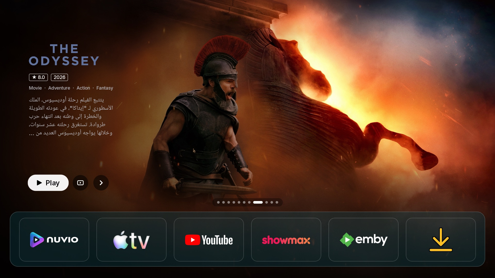
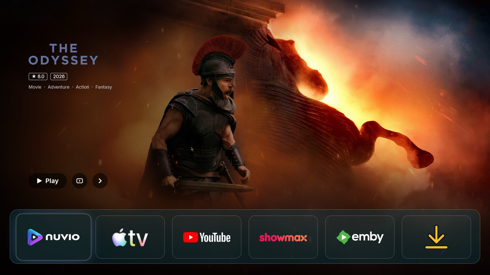
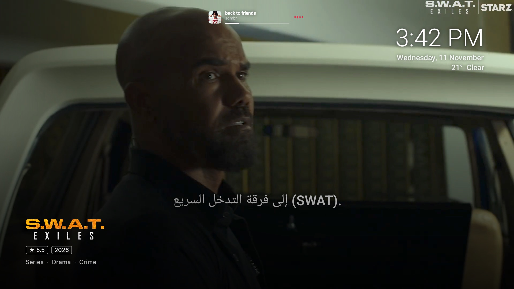
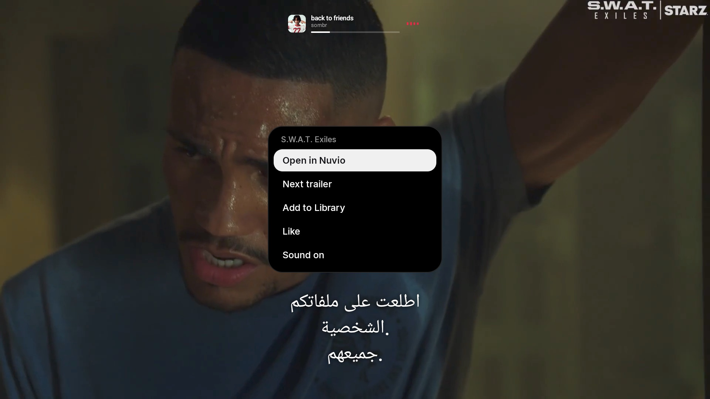
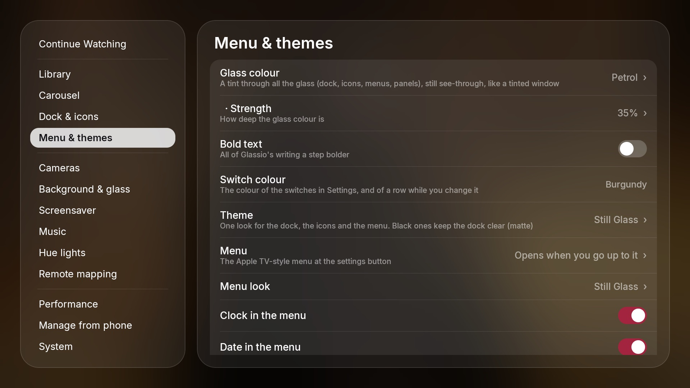
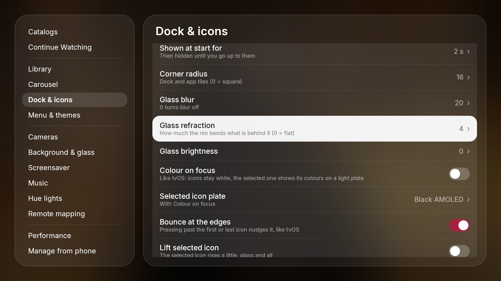
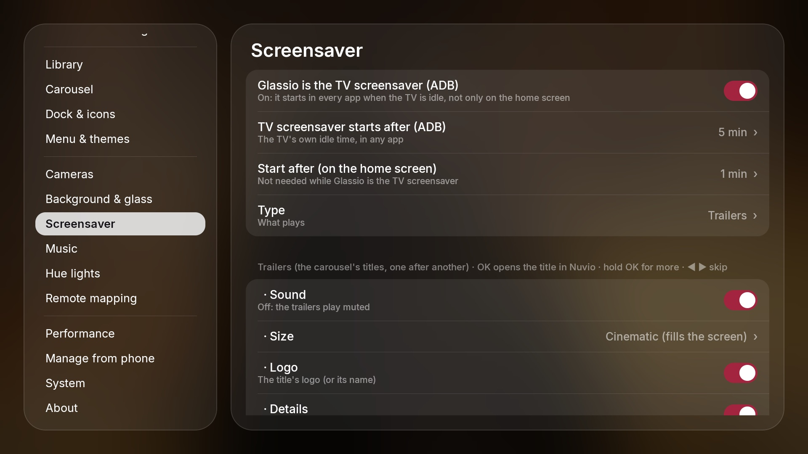
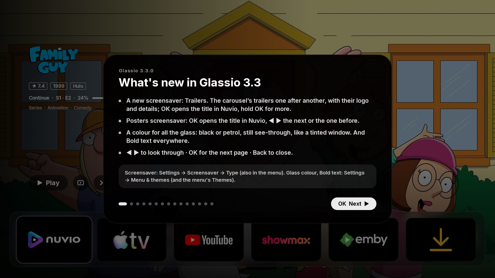
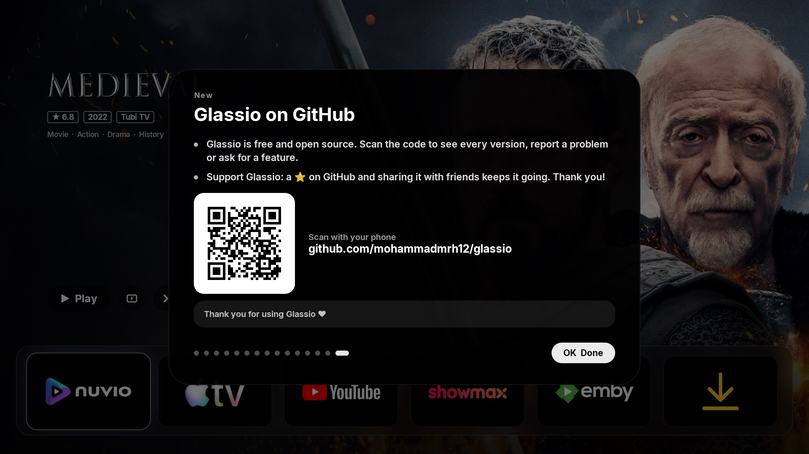
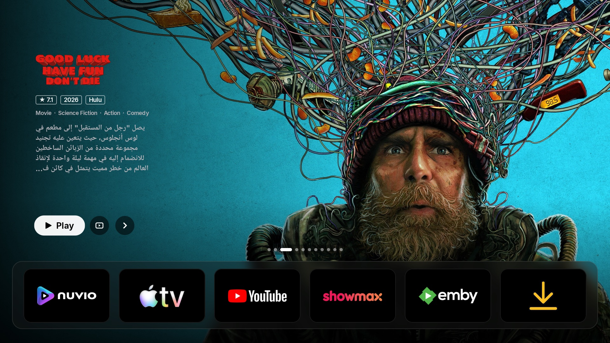

# سجل التغييرات

شنو تغيّر بكل نسخة من Glassio. التحميل: [Releases](https://github.com/mohammadmrh12/glassio/releases) · [English](../CHANGELOG.md)

## 3.6.0 — السنك بين تلفزيوناتك، بروفايل نوفيو، وزر الإعدادات
- **السنك** (الإعدادات ← Sync): تلفزيون واحد يكون الرئيسي والباقي يتبعونه على شبكة البيت، يا مباشر (أي تغيير بالرئيسي
  يطلع عليهم بعد لحظة) يا بس من تدوس Sync now. يلگون واحد الثاني وحدهم، وتربطهم مرة وحدة برمز من 4 أرقام يطلع
  بالرئيسي. كل تلفزيون يختار شياخذ: الشكل والثيم، الدوك والأيقونات، الشاشة الرئيسية، الچنلز والموسيقى، السكرين سيفر،
  الإضافات والكتالوجات، المكتبة واللايكات. ومطفية إلا إذا شغّلتها: المفاتيح (TMDB و Unsplash و Home Assistant)،
  جسر Hue، الكاميرات والجرس، أزرار الريموت، وقفل التطبيقات. وما تنتقل أبداً: تسجيلات الدخول (نوفيو، ستريمو، Trakt،
  Simkl)، الأداء ومداخل HDMI. وبالرئيسي أكو Pause sharing حتى تجرّب براحتك. السنك باتجاه واحد، من الرئيسي للباقي.
- **بروفايل نوفيو** (الإعدادات ← Connections): Continue Watching والمكتبة وإضافات الحساب تگدر تتبع بروفايل ثاني من
  حسابك (#16).
- **زر الإعدادات** (الإعدادات ← Menu & themes): سلايدرز، ترس، نقاط، خطوط، شخص أو "hello"، بمربع أو دائرة أو بدون
  إطار، ووياه ظل خفيف فوگ الصور الفاتحة.
- **الباك أب** يگلك شينتقل لتلفزيون ثاني وشيبقى، ويسألك قبل ما الاسترجاع يبدّل كلشي.

## 3.5.0 — الچنلز: روز التطبيق مكان الكاروسيل، وتطبيقات الموسيقى وأيقونة الميوزك
- **الچنلز** (الإعدادات ← Channels): من تحدد تطبيق بالدوك (يوتيوب، شاهد، برايم فيديو، نتفلكس…) تطلع الروز مالته
  (Continue watching، Recommended…) مكان الكاروسيل. ▲ يدخلك بيها، ▲ / ▼ تتنقل بين الروز (رو أو رويين بنفس الوقت،
  والباقي يطلع واحد ورا الثاني)، OK يفتح الكارت بالتطبيق، والرجوع يرجعك للتطبيق بالدوك. تگدر تختار الشكل، عدد
  الكارتات، الخلفية (رصاصي مثل المكتبة أو بلور الكارت)، التكبير والگلو مثل المكتبة، لون اسم التطبيق، Hue يتبع الكارت،
  وتخفي أو ترتب روز كل تطبيق.
- **تطبيقات الموسيقى بالدوك** تطلّع المشغل مالها حتى لو ماكو شي شغال (Play يكمل من وين وگف بدون ما يفتح التطبيق).
  الإعدادات ← Music / Channels: أي تطبيق موسيقى تگدر تخليه يطلّع الروز بداله.
- **أيقونة الميوزك** تطلّع تطبيقات الموسيقى (بنفس شكل أيقونات الدوك)، أو المشغل إذا أكو أغنية شغالة: OK يشغل،
  والضغطة الطويلة تفتح التطبيق. الإيقاف والمربع والنزول يرجعونك لأيقونة الميوزك.
- **المشغل يتبع التطبيق اللي يبدي يشتغل** (ساوندكلاود بعد سبوتفاي)، والآيلند يطلع فوگ الروز.
- **نوفيو وستريمو** يبقى عليهم الكاروسيل دائماً (والآيلند يطلّع الأغنية).
- **الكتالوجات ويه Torrentio**: رابط الإضافة اللي بيه "|" (إعدادات Torrentio) چان يوقف تحديث كل الكتالوجات (#15).

## 3.4.0 — صوت التريلر، شفافية زجاج الساعة، تطبيقات موسيقى أكثر، وأزرار للهيو ولكلاسيو
- **صوت التريلر** بالهوم (الإعدادات ← Carousel، وصفحة Trailer بالمنيو) وبسكرين سيفر التريلرات (إعداداته وقائمة الضغطة
  الطويلة). صوت التلفزيون نفسه يبقى مثل ما هو.
- **زجاج الساعة الكبيرة**: تتحكم بشفافية أرقام الزجاج لحد ما يصير زجاج صافي بس حافته (بالهوم وبالسكرين سيفر).
- **الموسيقى**: iHeart وSoundCloud وTuneIn وSiriusXM وQobuz وAmazon Music وغيرها؛ وأي تطبيق صوت بالتلفزيون المشغل يتابعه
  ويتحكم بيه. الآرت ورك يطلع حتى من التطبيقات اللي تدز رابطه بس (ساوندكلاود چان يطلع مربع رصاصي)، والأغنية اللي ما بيها
  آرت ورك يطلعلها آرت ورك كلاسيو الخاص.
- **أزرار الريموت**: زر يفتح **كلاسيو نفسه** (للريموت اللي زر الهوم مالته ما يشتغل، #13)، أو يطفي أضوية **Hue** لغرفة
  أو زون أو الكل (الضغطة الثانية تشغلهن).
- **مزامنة Hue**: كل الأضوية تاخذ اللون الجديد بنفس اللحظة (البلوم بعد ما تتأخر عن البلي بار).
- **أنعم**: فتح الدوك، استقرار سلايد الكاروسيل، والصعود السريع بالمكتبة يمر بالكونتنيو واتش ويوصل للدوك بدون ما
  الشريط يقفز.
- **Fire TV**: زر "Allow Glassio" (صلاحية ADB) صار يشتغل على الأجهزة اللي ما چانت تسأل (#14).

## 3.3.1 — مداخل HDMI على تلفزيونات الأندرويد العادي، وتصليحات السكرين سيفر
- **مداخل HDMI** صارت تنفتح على التلفزيونات اللي تشتغل أندرويد عادي بواجهتها الخاصة (بدون تطبيق Live TV، مثل اللوحات
  الصينية بواجهة Wisdom): كلاسيو يعرض المدخل بنفسه بشاشة كاملة، وزر الرجوع يرجعك. الإعدادات ← Menu & themes ←
  *Inputs open in*: تلقائي، تطبيق التلفزيون، أو كلاسيو.
- **سكرين سيفر التريلرات**: صورة العمل تطلع وقت ما أول تريلر يتحمّل (ماكو شاشة سودة)؛ إذا النت مقطوع يگول هذا بدل
  "No trailers found"، والرسالة تتحرك بالشاشة (حتى ما تحرك شاشات الأوليد)، والتريلرات ترجع وحدها من يرجع النت.
- تنظيف بالكود: خيارات وأيقونات ما مستخدمة انشالت، وتحذيرات المترجم انصلحت.

## 3.3.0 — سكرين سيفر التريلرات، لون الزجاج، خط عريض وتصليحات هواية
- **سكرين سيفر التريلرات** (الإعدادات ← Screensaver ← *Type*، وبالمنيو هم): تريلرات أعمال الكاروسيل ورا بعض، ويا لوكو
  العمل وتفاصيله مثل الكاروسيل، والترجمة فوكهن. **OK** يفتح العمل بنوفيو، **الضغط المطول** يطلع قائمة (فتح بنوفيو،
  التريلر الجاي، اللايبرري، لايك، الصوت)، و **◀ ▶** يقلبن. الصوت، الحجم سينماتك أو أصلي، اللوكو، التفاصيل، القصة، حجم
  الترجمة ومدة ظهور التفاصيل كلها خيارات. الساعة تبتعد عن زاوية اللوكو.
- **سكرين سيفر البوسترات**: OK يفتح العمل بنوفيو، و ◀ ▶ للي بعده أو اللي قبله.
- **لون الزجاج** (الإعدادات ← Menu & themes، وبثيمات المنيو): صبغة بكل الزجاج — الدوك والأيقونات والقوائم — **أسود**
  أو **نفطي**، يبقى شفاف مثل تظليل الجامة، ويا خيار للقوة. ما يتغير وقت تبديل السلايدات.
- **خط عريض** لكل كتابات كلاسيو (الإعدادات ← Menu & themes).
- **التريلرات**: إذا Cinemeta ما بيه تريلر يدوّر بـ **TMDB** وبعدين **ببحث يوتيوب**؛ دائماً أعلى جودة بالمصدر (لحد دقة
  الشاشة، 4K على تلفزيون 4K)؛ الترجمة **سطر سطر** (ما تصعد بعد) ويا **حجم** خاص بيها؛ النافذة ما تطلع برا الشاشة وتظهر
  ويا أول إطار؛ وتبدي أسرع.
- **الإعدادات تتذكر وين چنت**: تنفتح على نفس الصفحة والسطر.
- **الفوكس ما يختفي**: بعد الفولدر والهوم، أو تطبيق من الفولدر، دائماً يرجع الاختيار.
- **الميوزك مود**: صفحة الأغنية تبقى من تنزل للدوك، وما تطلع وحدها من يشتغل كلاسيو وأغنية متوقفة.
- **الكاروسيل**: يقلب وحده حتى وهو مختار (أغنية متوقفة چانت توقفه)، شغله بين السلايدات صار موزع (المعالج أهدى)،
  والسكرين سيفر ما يبقى شغال مخفي وراه.
- **اللايبرري**: الضغط المستمر أسرع.
- **الإعدادات**: مسافات أوسع بين المجاميع؛ خيارات شكل الدوك (البلر، الانحناء، السطوع، التوهج، تكبير الأيقونة، الزوايا،
  الإخفاء التلقائي) صارت بـ **Dock & icons**؛ ومعلومات السكرين سيفر تحت *On screen*.
- جولة "الجديد" بيها كل شي جديد، وآخر صفحة دائماً باركود كلاسيو على GitHub.
- إعدادات افتراضية جديدة للتنصيب الجديد (التريلر بأعلى جودة وبنافذة، الميوزك مود، الدوك بالأسفل…).

| | |
|---|---|
|  |  |
|  |  |
|  |  |
|  |  |
|  |  |

## 3.2.2 — تصليح التريلرات
- التريلر ما يطفي وحده بعد كم ثانية، والصوت ما يطلع مرتين: زر بالريموت أو الضغط المطول على الهوم چان يفتح نسخة ثانية
  من كلاسيو جنب الأولى، والثنتين يشغلن التريلر.

## 3.2.1 — كل أيقونات الباك، بحث بالأيقونات، والتطبيقات الأخيرة بدون USB debugging
- باكات الأيقونات صارت تطلّع **كل الأيقونات** اللي بيها، حتى اللي مو مربوطة بتطبيق (باكات Projectivy / Blueprint
  چانت تطلّع قسم منها بس).
- **بحث بالأيقونات** بشاشة تغيير الأيقونة (ضغط مطول على OK ← Change icon): تكتب جزء من الاسم ويدوّر بكل الباكات مرة وحدة.
- **التطبيقات الأخيرة بدون USB debugging**: كلاسيو يعرض التطبيقات اللي استخدمتها مؤخراً من خدمة زر الهوم، فما يحتاج
  ADB يبقى شغال. إذا USB debugging شغال القائمة دقيقة مثل قبل (الخيار: الإعدادات ← Remote mapping ←
  *Recent apps use TV access*). و *Usage access* اختياري يضيف التطبيقات اللي انفتحت قبل كلاسيو.

## 3.2.0 — Remote mapping
- **Remote mapping** (الإعدادات ← **Remote mapping**، #12): تنطي أي زر بالريموت تطبيق، أو **فولدر التطبيقات**، أو
  **التطبيقات الأخيرة**، أو **مدخل** (HDMI…)، ويشتغل داخل أي تطبيق (ويا خدمة زر الهوم). تضغطه مرة ثانية ينسد الفولدر
  أو التطبيقات الأخيرة. الشفل، المالتي فيو، كاميرا الزاوية، الضغط المطول على الهوم والباك للسكرين سيفر كلها هنا هم.
- قائمة التطبيق المقفول (ضغط مطول على OK) تطلب الرمز أول، وتسجيل الخروج من أي حساب يسأل قبل.
- السطر اللي تغيّره بـ ◀ ▶ ياخذ **لون السويتشات** (برغندي، أخضر أو بنفسجي).
- تصليحات: بالميوزك مود فتح الدوك چان يطلّع خلفية العنوان، والفوكس يرجع دائماً بعد السكرين سيفر والفولدر والتطبيقات الأخيرة.

## 3.1.0 — Hue Sync، إعدادات جديدة ويا بحث، وسيرفر نوفيو خاص
- **Hue Sync** (الإعدادات ← **Hue lights**): أضوية فلبس هيو تاخذ ألوان الشاشة: الخلفية، البوستر أو اللوكو، الفيديو،
  التريلرات، فيديوهات السكرين سيفر وصورة الأغنية.
  - كل لايت ياخذ لونه من جهة من الشاشة (يمين، يسار، فوك، الزوايا، شريط كرادينت على الأطراف…) ويا صورة توضيحية لكل خيار،
    أو من مكانه بالـ **entertainment area** مال تطبيق Hue. خيار *Blink it* يخلي اللايت يرمش حتى تعرفه.
  - أضوية فلبس تاخذ اللون ضمن مداها، والتجارية (ليفارنو، Tuya…) تاخذه بالـ hue و saturation.
  - اختياري: الأضوية تاخذ لون **التطبيق الي واقف عليه بالدوك** أو **البوستر باللايبرري**، كل واحد بسطوعه الخاص.
  - من تفتح تطبيق أو فلم أو تطفي التلفزيون: ترجع مثل ما جانت، أو تخفت، أو تنطفي، أو تبقى.
- **الإعدادات**: مرتبة مثل الآيفون (كروت مدورة وخطوط رفيعة)، **بحث** بكيبورد داخلي، أخف وأسرع، ولون السويتشات
  (برغندي، أخضر، بنفسجي).
- **الإدارة من الموبايل**: شكل جديد مثل اعدادات الآيفون، فاتح وداكن، ويا بحث.
- **نوفيو**: سيرفر نوفيو خاص (عنوان، مفتاح، صفحة تسجيل دخول اختيارية) وتسجيل دخول بالإيميل.
- **Home Assistant**: Glassio يدز حالة تشغيل نوفيو للهوم أسستنت ويستقبل منه بوز وتشغيل وسيك.
- **الموسيقى**: أيقونة الموسيقى بالدوك تفتح صفحة الموسيقى، البوز والتشغيل يتغيرون فوراً، واسم الأغنية يتبدل بمكانه.
- **المكتبة**: الضغط المطول للأسفل صار ينزل بإيقاع ثابت وناعم.
- **الكاميرات**: الملتي فيو يضبب كلشي وراه، والسكرين سيفر ما يشتغل وقت التريلر.

## 3.0.0 (ومن 2.0.8) — موسيقى، تريلرات، مداخل، وسكرين سيفر جديد
- **جولة الجديد**: بعد كل تحديث تطلع جولة قصيرة تعرّفك على الميزات الجديدة ووين تطفيها أو تخصصها (الإعدادات ← About ← *What's new* ترجعها).
- **الموسيقى** (الإعدادات ← **Music**): اللي يشتغل من أي تطبيق موسيقى (Spotify، YouTube Music، Apple Music، أنغامي، يوتيوب…).
  - **وضع الموسيقى**: الهوم يصير مشغل كامل ويه صورة الألبوم مضببة، والأغاني تتبدل بـ fade.
  - مشغل صغير بالقائمة (▶)، أيقونة Music بالدوك، و**آيلاند** على السكرين سيفر والهوم: للأعلى يفتحها ويا الأزرار وللأسفل يسدها.
  - تشغيل، تقديم، **شفل** (نفسه بكل المشغلات) و**إيقاف** من أي مكان.
  - الآيلاند والساعة الكبيرة يمشون ويا الثيم: أسود، أبيض، فروستد، كلير أو ستل كلاس.
- **التريلرات**: تريلر العنوان يشتغل بمكان صورته بمشغل Glassio نفسه (بلا أزرار يوتيوب، يبدي بثانية تقريباً)، **سينماتك** (يملي الشاشة بلا أشرطة سودة) أو **أوريجنال** أو **نافذة**.
  - **ترجمة بلغتك**، وتنترجم إذا يوتيوب ما عنده.
  - **يشتغل وحده** بعد ثواني على العنوان، بس من يكون التحديد على الكروسيل (أبداً من الدوك).
  - صفحة **Trailer** بالقائمة (تشغيل وإيقاف، تلقائي ووقته، الحجم، الدوك، الترجمة، الصوت)، و**OK مطوّل على بوستر بالمكتبة ← Trailer**.
- **المداخل**: مداخل HDMI مال التلفزيون وأجهزة HDMI-CEC (بليستيشن، رسيفر…) بالقائمة وكأيقونات بالدوك.
- **الكاميرات**: عرض لحد 4 كاميرات سوة، كاميرات Home Assistant، وأزرار بالريموت إلها.
- **السكرين سيفر**: ساعة كبيرة بكلاس الثيم (للأعلى تطلعها وتخفيها)، OK مطوّل **يقفل** فيديو يعجبك (*Locked only* يشغل بس هذني)، للأسفل الكاميرات، ويطلع بهدوء من الأسود.
- **متابعة المشاهدة** نفس نوفيو بالضبط، ويا **Next Up** (الحلقة الجاية للمسلسلات اللي خلصتها)، و *Open in* تختار بيه التطبيق.
- **أنعم**: الفروستد كلاس صار سلس مثل الكلير، تشغيل أسرع وكروسيل أنعم.

## 2.0.5 و 2.0.6 — خلفيات، ساعة كلاس، قفل التطبيقات وجرس الباب
- **الخلفيات** (الإعدادات ← **Background & glass**): خلفيات العناوين، **صور 4K** (Bing، Wikimedia Commons، Unsplash بمفتاح مجاني، أو صورك)، **فيديوك**، أو **فيديوات السكرين سيفر**. لكل وحدة **Next** و **Shuffle**، تتبدل بتلاشي مثل السكرين سيفر، وتنحفظ بكاش ينمسح منه الأقدم. والمكان والمصدر يطلعون على الخلفية مثل السكرين سيفر.
- **ساعة كبيرة** على الخلفية من نفس كلاس الدوك (أو بيضة). حجمها ومكانها يتغيرون، وإعداد **Glass blur** يطبق عليها، وتتحرك ويا فيديو الخلفية.
- **Depth effect** للصور: الشي اللي بالصورة يطلع گدام الساعة (يتسوى على التلفزيون نفسه، للصور بس).
- **قفل التطبيقات**: رمز من 4 أرقام لأي تطبيق (الافتراضي 0000). OK مطوّل على التطبيق ← Lock. تطلع نافذة كلاس للرمز وينفتح أول ما يصح الرمز، ويا تلميح اختياري. القفل يشتغل بس للتطبيقات اللي تنفتح من Glassio.
- **جرس الباب من Home Assistant**: الكاميرا تطلع بالزاوية فوق أي تطبيق، ويا رنة خفيفة وكلام تختاره (جاهز بالعربي أو الإنكليزي). شوف [جرس الباب](#جرس-الباب).
- **الكاميرات**: *Find cameras* يضيف كل قنوات جهاز التسجيل (NVR/XVR). تگدر تختار كاميرا الجرس، تخليها تلف على كاميراتك، وتغيّر حجم كاميرا الهوم المطوّل.
- **Sharp corners** للقوائم والدوك والأيقونات. أسماء الثيمات الجديدة: **Dynamic Glass**، **Still Glass**، **Frosted Glass**.
- الكلاس أنعم بكل الثيمات ويمشي ويا الخلفية، والرام أقل بهواية ويا خلفيتك الخاصة.

## 2.0.4
- الرجوع من الإعدادات صار سلس من أول لحظة (الهوم والمكتبة ما ينبنون من جديد).
- **المزامنة** صارت تنقل الحذف اللي تسويه بنوفيو أو Trakt أو Simkl للحسابات الثانية، وتگول شنو صار بكل حساب. و Glassio يلتزم بحد الطلبات اليومي مال Simkl.
- القوائم الزجاجية ما يطلع منها الريموت، وزر الخلط يشتغل بأي زر بالريموت.

## 2.0.3
- **ضغط مطول على OK فوك زر Play**: قائمة زجاجية صغيرة تضيف بيها العنوان للمكتبة، تسويله **لايك** (ينبعث لـ Trakt و Simkl)، أو **تغير صورته** من صور مصغرة. تطبيقات الدوك هم صارت بنفس القائمة.
- **مزامنة** (الإعدادات ← Connections): المكتبة واللايكات ومتابعة المشاهدة نفسها على نوفيو و Trakt و Simkl.
- **زر الخلط**: تختار أي زر بالريموت يخلط الكروسيل، والعناوين الجديدة بالكتلوك تطلع بالبداية.
- كاميرا الزاوية تگدر تتنقل بين الكاميرات وحدها.
- اللوكوات تطلع أسرع، ويطلع اسم العنوان إذا اللوكو ما موجود. إطفاء متابعة المشاهدة بالكروسيل ما يشيلها من المكتبة.

## 2.0.2
- **الإعدادات ← Cameras**: كل شي يخص الكاميرات بمكان واحد، وتختار أي كاميرا تطلع من تضغط مطول على الهوم وشكد تبقى (20 ثانية افتراضياً).
- بعد ما يرجع التلفزيون من الاستعداد يفتح Glassio بدل لانشر گوگل.
- فيديوهات السكرين سيفر والصور تترك دائماً 3 GB فاضية على التلفزيون، والرجوع من أي تطبيق صار أسرع.
- النزول من متابعة المشاهدة يروح للبوستر اللي تحت البطاقة بالضبط.

## 2.0.1 — المكتبة تتصفح مثل Apple TV
- كل ضغطة انزلاقة وحدة ناعمة وتكمل بنفس السرعة من تضغط مستمر، والصف المختار عالي بالشاشة، والصفوف تنبني قبل لا توصلها، و60 إطار ثابتة على التلفزيون.
- زوم أكبر للبوستر المختار، ظل خفيف تحت كل البوسترات وأقوى تحت المختار، مسافة أكبر بين الصفوف، والبوسترات تتحمل مسبقاً بالكاش. ماكو هزة بالتصفح يمين ويسار، وراس الصفحة ما ينقص.
- الإعدادات ← Library: **حجم البوستر**، **عدد البوسترات بكل صف**، و**المسافة بين البوسترات**.

## 2.0.0 — تنقّل أنعم وأسرع بكل مكان
- **الإعدادات**: تغيير أي خيار شكل (مثل *Settings background*) يخليك بنفس مكانك والريموت يبقى بالإعدادات، و يمين / OK يدخل للخيارات دائماً (الدوك اللي ورا ما يأخذ الريموت بعد). قائمة الأقسام تنعرض كلها، والنزول والصعود السريع ثابت بلا قفزات.
- **الدوك والمكتبة**: فتح وسد الدوك أخف بحدود الثلث على كرت الشاشة، والصعود السريع من المكتبة يوقف عند الدوك وما يكمل للكروسيل والقائمة.

## 1.9.9
- **إعداد أول مرة**: شاشة ترحيب زجاجية — استعادة نسخة احتياطية، اختيار الشكل، ربط نوفيو وستريمو و Trakt و Simkl بـ QR من نفس الشاشة (✓ بعد الربط)، إضافة الكتلوكات من الموبايل، أو *Later*.
- **كل الحسابات بمكان واحد** (الإعدادات ← **Connections**): نوفيو، ستريمو (QR أو إيميل)، Trakt، Simkl، TMDB، Home Assistant والكاميرات. متابعة المشاهدة من **ستريمو** و **Simkl**، وكتلوكات من إضافات حساب ستريمو. الحذف هنا يحذف بالتطبيق الأصلي هم.
- **المكتبة**: تنفتح بـ **نزول من الدوك** وتصعد مثل Apple TV (الصعود من أول صف يرجعك للدوك). صف **متابعة المشاهدة** بي مصدر كل عنوان (نقطة بلون التطبيق) والحلقة والتقدم داخل الكارت — شكل خلفية أو بوستر وحجم. تأكيد قبل الحذف. قائمة *Plan to watch* مال Simkl.
- **سكرين سيفر جديد**: مجموعات [aerial-videos.netlify.app](https://aerial-videos.netlify.app) (Apple tvOS، Amazon، Jetson Creative، Robin Fourcade) وفيديوهاتك، بدقة **4K و HDR و Dolby Vision فعلية**، وتنحفظ على التلفزيون. تلاشي بين الفيديوهات، عشوائي أو فيديو واحد (ويه صورة لكل فيديو)، **◀ ▶ تبدل الفيديو و OK يخفي المعلومات**. الساعة والتاريخ والطقس والمكان ومعلومات التلفزيون بستايل **أبل** أو **نتفلكس** (سطر بعد سطر، الخط أحمر أو أبيض أو أسود، ويختفي بعد ما يكمل). Glassio يگدر يصير **سكرين سيفر التلفزيون نفسه** بكل التطبيقات.
- **القائمة**: الحجم والترتيب، **معلومات التلفزيون** (IP، CPU، GPU، RAM، التخزين)، **كاميرا مباشرة** (RTSP / HLS، بحث ONVIF) ويه علامة LIVE، وصفحة السكرين سيفر.
- **الدوك**: يتصغر على عدد التطبيقات، يختفي تحت الشاشة، بالنص أو عمود يسار ويه خلفيتك الخاصة، **تكبير الأيقونة** داخل الكلاس أو الكارت كله، و**توهج** خفيف بلون التطبيق أو أبيض.
- **الضغط المطول على Home**: التطبيقات المفتوحة مثل Apple TV (▲ يسكّر التطبيق فعلياً)، كاميرا بالزاوية فوك أي تطبيق، المكتبة أو القائمة.
- **الكروسيل**: *Surprise me*، **لوكو أبيض** مثل أبل، تشغيل وإطفاء زر +، صور **1280 محسّنة**، وكاش أكبر.
- **نسخ احتياطي واستعادة** لكل الإعدادات والكتلوكات والمكتبة والحسابات. **التشغيل ويه التلفزيون**، **9 لغات**، و**الإدارة من الموبايل** تبقى شغالة بعد ما تطلع وبيها الحسابات والكاميرات والنسخ الاحتياطي.
- أسرع: خلفية الفيديو تاخذ أقل من نص المعالج، الدوك والمكتبة بـ 60 إطار، وما يرجع لـ Glassio من يرجع الواي فاي.

## القائمة، المكتبة، الثيمات والخلفية (1.9.5)
- **القائمة**: من تصعد لزر الإعدادات تنفتح قائمة مثل ابل تي في: الساعة، التاريخ، الطقس، ثم Library، Glassio settings، Android settings، Wi-Fi، Themes، Background. تنفتح تلقائي أو بـ OK أو تنطفي (الإعدادات ← Menu, Library & themes)، وكل جزء بيها إله زر إخفاء.
- **المكتبة**: زر **+** بين Play والتالي يحفظ العنوان. 5 بوسترات بالصف، OK يفتح العنوان، OK مطوّل يحذفه. تطلع بيها **مكتبة حساب Nuvio** (Legacy والأصلي والفوركات اللي تتزامن ويا الحساب، تسجيل بـ QR) و**Watchlist مال Trakt**، و+ يحفظ بيهن هم.
- **الثيمات**: Black on white، Black AMOLED، Frosted Glass، Clear، Still Glass، Dynamic Glass للدوك والأيقونات والقائمة، ويا *Colour on focus*.
- **الخلفية**: خلفية كل عنوان، أو **صورتك**، أو **فيديوك** (رابط أو ملف بمجلد الخلفيات اللي مكتوب بالإعدادات ← Clock & glass)، أو **فيديوات السكرين سيفر**. ويا خلفيتك الخاصة تختفي التفاصيل والأزرار، والكلاس يتحرك ويا الفيديو.
- **تفعيل خدمة الأكسسبلتي بـ ADB** من الإعدادات ← System للأجهزة اللي تمنعها (Google TV Streamer).

