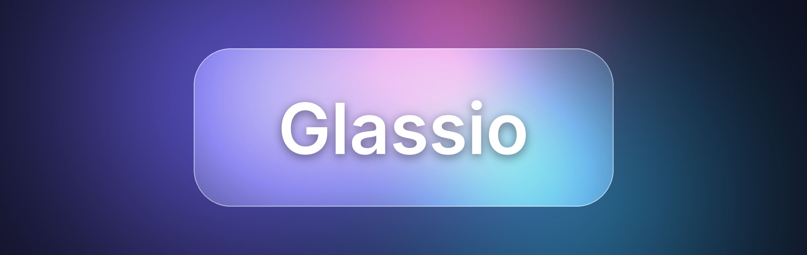
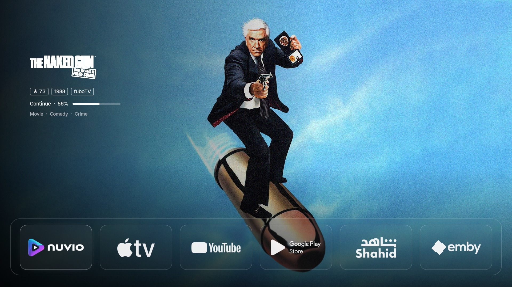
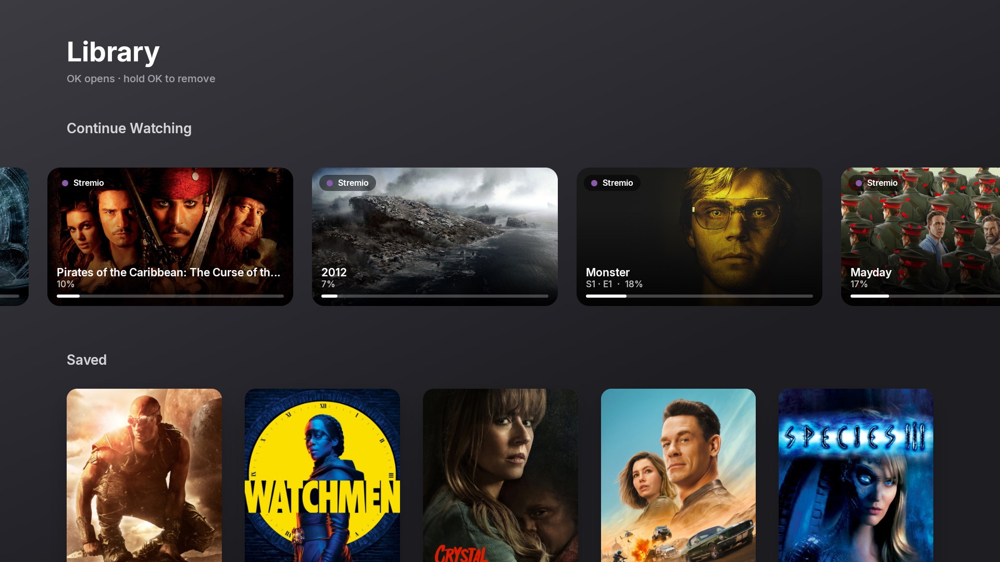
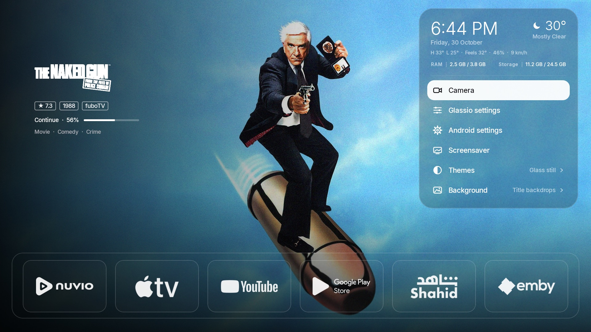
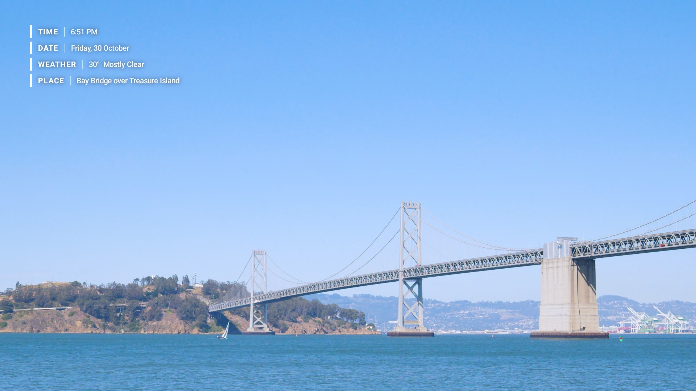
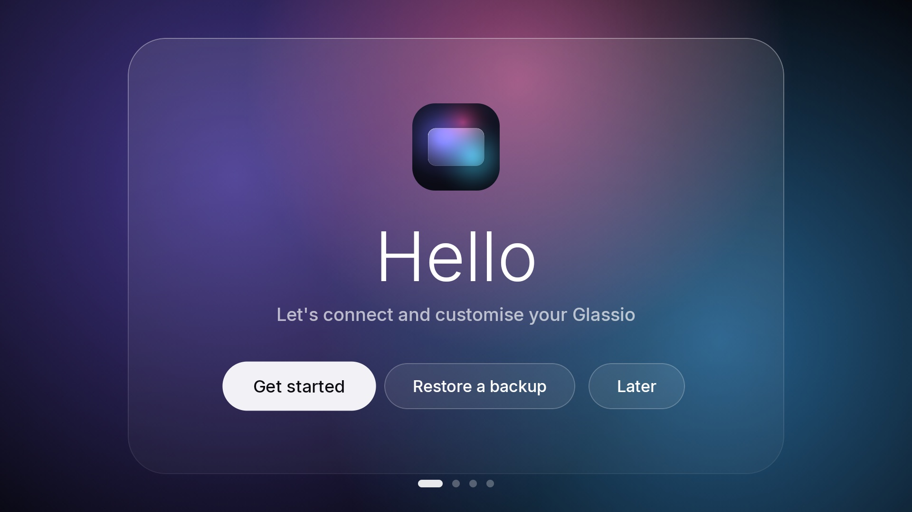
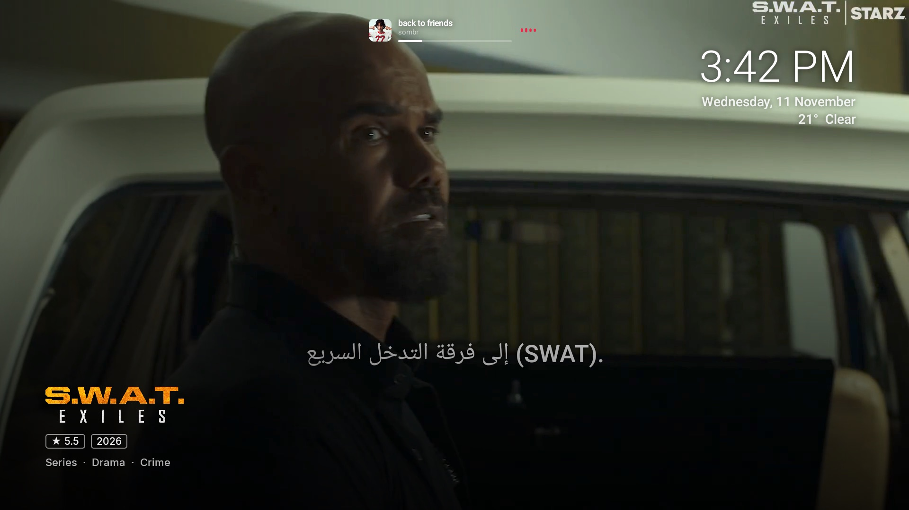
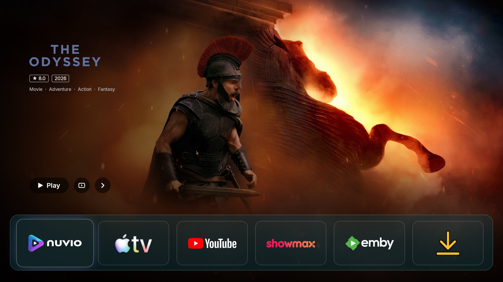

<p align="center">
  <a href="https://www.reddit.com/r/glassio_/"></a>
  <a href="https://github.com/mohammadmrh12/glassio/releases/latest"></a>
  <a href="https://github.com/mohammadmrh12/glassio/discussions"></a>
</p>

<div dir="rtl">

# Glassio — دليل الاستخدام

لانشر لـ Google TV / Android TV بشكل Apple TV: زجاج سائل حقيقي، كروسيل من كتلوكات نوفيو وستريمو ويا تريلرات، چنلز
كل تطبيق، وضع موسيقى، "متابعة المشاهدة" من نوفيو وستريمو و Trakt و Simkl، سكرين سيفر 4K و HDR، أضواء Hue، كاميرات،
Home Assistant، وسنك بين تلفزيوناتك.



| | |
|---|---|
|  |  |
|  |  |
|  |  |

[English](../README.md) · [سجل التغييرات](CHANGELOG.ar.md)

## المميزات

آخر نسخة: **3.6.0** — السنك بين تلفزيوناتك، بروفايلات نوفيو، وزر إعدادات جديد. شنو تغيّر بكل نسخة:
[سجل التغييرات](CHANGELOG.ar.md).

- **الشاشة الرئيسية** — كروسيل من كتلوكات نوفيو وستريمو ويا تريلرات (بترجمة بلغتك)، لوكوات، معرض صور، ومتابعة المشاهدة،
  ويفتح العناوين بنوفيو أو ستريمو.
- **الزجاج السائل** — انكسار حقيقي، ست ثيمات، لون للزجاج (أسود أو نفطي)، خط عريض، وزوايا مدورة أو حادة.
- **الدوك والأيقونات** — تحديد بأسلوب tvOS ويا گلو وارتداد، حزم أيقونات ومكتبة أيقونات Apple TV، مجلد تطبيقات، وقفل للتطبيقات.
- **الچنلز** — تحدد يوتيوب أو شاهد أو نتفلكس… بالدوك وتطلع الروز مالته مكان الكروسيل.
- **الموسيقى** — اللي شغّال من أي تطبيق موسيقى: وضع موسيقى بالشاشة كلها، آيلند، وأيقونة الميوزك.
- **المكتبة والحسابات** — متابعة المشاهدة والقوائم من نوفيو (أي بروفايل)، ستريمو، Trakt و Simkl، ومتزامنة بيناتهم.
- **السكرين سيفر** — فيديوات جوية 4K / HDR / Dolby Vision، تريلرات أو بوسترات، والساعة والمعلومات بأسلوب Apple أو Netflix.
- **الخلفيات** — صور 4K، صورتك أو فيديوك، وساعة زجاج كبيرة ويا تأثير العمق.
- **السنك بين التلفزيونات** — تلفزيون رئيسي والباقي يتبعونه مباشرة على شبكة البيت، وكل واحد يختار شياخذ.
- **البيت الذكي** — أضواء Hue تتبع الشاشة، كاميرات وعرض متعدد، جرس الباب، و Home Assistant.
- **التلفزيون والريموت** — مداخل HDMI، أي زر بالريموت تخليه يسوي شي، ومبدّل التطبيقات بضغطة هوم الطويلة.
- **القائمة** — مركز تحكم من زر الإعدادات: الطقس، معلومات التلفزيون، كاميرا، المداخل، الثيمات، والموسيقى.
- **سهل** — إعداد أول مرة ويا تسجيل دخول بـ QR، باك أب واسترجاع، تحكم من الموبايل، 9 لغات، تحديثات من GitHub،
  وإعدادات أداء للتلفزيونات الضعيفة.

## التثبيت
1. نزّل `Glassio-x.y.z.apk` من صفحة [Releases](https://github.com/mohammadmrh12/glassio/releases).
2. ثبّته على التلفزيون عن طريق تطبيق Downloader، أو فلاشة، أو من الكمبيوتر:
   `adb connect <ip>:5555` ثم `adb install -r Glassio-x.y.z.apk`
3. افتح Glassio من التطبيقات. أول مرة تطلع شاشة الإعداد: الحسابات والكتلوكات والشكل.

## خليه اللانشر الأساسي (زر الهوم)
كوكل تي في دائماً يوجّه زر الهوم للانشر مالته، فاللانشر يستخدم خدمة إمكانية الوصول:
1. الإعدادات ← **System** ← *Turn on the accessibility service* ← Glassio ← تشغيل.
2. مُستحسن (حتى تبقى الخدمة شغالة بعد التحديثات): من الكمبيوتر مرة وحدة
   `adb shell pm grant com.glasslauncher.tv android.permission.WRITE_SECURE_SETTINGS`
3. أول مرة يستخدم اللانشر adb مال التلفزيون (سكرين سيفر التلفزيون، متابعة المشاهدة، التحديث الصامت) تطلع رسالة
   **Allow USB debugging** — فعّل **Always allow** واضغط **Allow**. لازم *Network debugging* يكون مفعّل من خيارات المطور.

## الكتلوكات (إضافات نوفيو)
- الإعدادات ← **Catalogs** ← *Add add-ons from my phone (QR)*: امسح الكود بالموبايل (نفس الواي فاي) والصق روابط
  `manifest.json` وتوكن TMDB.
- أو *Connect to Nuvio*: بنوفيو افتح Add-ons ← Manage from phone أولاً، بعدين اضغط Connect.
- اختار الكتلوكات اللي تريدها.

## توكن TMDB (لوكوات، صور كاملة، ساينوبسس، تقييم، معرض الصور)
سجّل بموقع themoviedb.org ← Settings ← API ← انسخ **API Read Access Token**، وحطه بالإعدادات ← Catalogs ← TMDB token.

## متابعة المشاهدة
- تشتغل ويه **Nuvio Legacy**: نوفيو ليكسي يكتب شنو تشوف (العنوان، الحلقة، وين وصلت) بسجل التلفزيون، واللانشر يقراه
  عن طريق اتصال التصحيح مال التلفزيون نفسه (ADB، شوف تحت). ماكو شي يطلع من التلفزيون.
- **Trakt**: الإعدادات ← Continue Watching ← *Connect Trakt account* يطلعلك كود، تكتبه بـ trakt.tv/activate من الموبايل
  (بدون باسورد على التلفزيون). بعدها أي شي توقفه بتطبيق مربوط بـ Trakt (نوفيو الأصلي، Nuvio Arc، Re-Shaped، Stremio، Kodi…)
  يطلع بمتابعة المشاهدة. نوفيو الأصلي و Arc و Re-Shaped ما يكتبون سجل Legacy، فلهم استخدم Trakt.
  باقي التطبيقات (نتفلكس، يوتيوب…) كوكل تي في ما يسمح بقراءة متابعتها.
- الإعدادات ← **Continue Watching**: ببداية الكروسيل / مدموجة / مطفية، كم سلايد بالبداية، يفتح على آخر شي شفته،
  شريط التقدم، مسح القائمة.
- العنوان يطلع من القائمة لما تخلصه (أكثر من 92%) أو تحذفه. صور هالعناوين تبقى محفوظة بالذاكرة، فالرجوع إلها ما يحمّل من جديد.

## تفعيل ADB (مرة وحدة)
متابعة المشاهدة من Nuvio Legacy، Glassio كسكرين سيفر التلفزيون، معلومات التلفزيون (CPU / GPU)، التطبيقات المفتوحة، التشغيل ويه التلفزيون والتحديث الصامت تحتاج ADB. الإعدادات ← **System**:
1. **Open About** ← اضغط OK على *Android TV OS build* (أو *Build*) **7 مرات** لحد ما يگلك صرت مطور.
2. **Open Developer options** ← فعّل **USB debugging** (ببعض الشاشات هم *Network debugging*).
3. **Allow Glassio** ← التلفزيون يسأل *Allow USB debugging?* ← أشّر **Always allow from this computer** ← OK. تنسأل مرة وحدة بس.

## فتح العناوين
الإعدادات ← Connections ← *Open titles in*: **Auto** (أول تطبيق منصّب بهالترتيب: Nuvio Legacy، نوفيو الأصلي،
Nuvio Arc، Nuvio Re-Shaped، Stremio) أو تختار واحد بنفسك. لغة الساينوبسس: الإعدادات ← Carousel ← *Synopsis language* (24 لغة).

## الكروسيل
- الإعدادات ← Carousel ← **Slide animation**: **Apple TV** (الافتراضي: الصورة الجاية تنفتح من اليمين مثل ابل تي في، والرجوع بالعكس، ويه الكلاس)، *Slide*، أو *Fade*.
- **Buttons**: **Play + Next** (الافتراضي: يمين من Play يحدد الزر الدائري، يمين أو OK عليه يبدّل للعنوان الجاي، يسار على Play للي قبله، ومكان الزرين ثابت)، *Play only*، أو مخفية.
- **Dots**: نقاط عادية، **Liquid glass dots** (قطرات كلاس صافية على كبسولة كلاس، تتمطّ وتلتحم وتنفصل مثل الماي)، شريط تقدم، أو مخفية.

## الأيقونات
- مجلد التطبيقات: الإعدادات ← Dock & icons ← *Show Apps folder* (أو OK مطوّل على المجلد ← *Hide from the dock*).
- اضغط **OK** مطولاً على أي تطبيق ← **Change icon**: المقترحة، أيقونات Apple TV (أصلي/دارك/وايت/كلير)، أي حزمة
  أيقونات (Projectivy, Blueprint, Nova)، صور التلفزيون، رابط، الموبايل، أو الأصلية.
- الإعدادات ← Clock & glass: **Colour on focus** (الأيقونات بيضة وتتلون عند التحديد)، لون البلاطة فاتح/غامق،
  حركة الحافة، رفع الأيقونة.

## الطقس
الإعدادات ← Clock & glass ← **Weather** (كلشي / الحرارة + السماء / الحرارة + المدينة / الحرارة / إطفاء)،
**Weather city** (عربي أو إنكليزي — المكان اللي ينلكه يطلع يمه)، فهرنهايت. مكان الساعة: يسار مثل أبل أو يم الإعدادات.

## السكرين سيفر
الإعدادات ← **Screensaver**:
1. *Type*: **فيديوهات جوية** (الافتراضي)، بوسترات ويه اللوكو، أو سكرين سيفر التلفزيون.
2. شغّل المجموعات اللي تحبها و/أو **My videos** (روابطك وفيديوهات مجلد الخلفيات)، و *Quality*: 1080 H.264، 1080 HEVC، 4K، HDR، Dolby Vision.
3. **Glassio is the TV screensaver (ADB)**: يشتغل بكل التطبيقات من يبقى التلفزيون بدون استخدام.
4. وهو شغال: **◀ ▶** تبدل الفيديو، **OK** يخفي المعلومات أو يرجعها، وأي زر ثاني يطلعك.

## الأداء
الإعدادات ← **Performance**: *Performance* (أسلس: صور 1280، انتقال سريع، زجاج مسطح)، *Balanced*، *Quality* (صور أصلية،
زجاج كامل). تكدر تغيّر كل إعداد لحاله (يصير الوضع *Custom*).

## ربط Home Assistant
اللانشر يرسل JSON لويب هوك بالهوم اسستنت كل ما تفتح عنوان من الكروسيل:
`{"event":"launch","title":"…","type":"movie|series","id":"tt…","app":"…"}`

1. بالهوم اسستنت: Settings ← Automations ← Create ← Edit in YAML والصق:

</div>

```yaml
alias: Glassio – title opened
mode: queued
triggers:
  - trigger: webhook
    webhook_id: glass_launcher_CHANGE_ME
    allowed_methods: [POST]
    local_only: true
actions:
  - event: glass_launcher
    event_data:
      title: "{{ trigger.json.title }}"
      type: "{{ trigger.json.type }}"
      id: "{{ trigger.json.id }}"
  - if: "{{ trigger.json.event == 'launch' }}"
    then:
      - action: light.turn_off
        target: { area_id: living_room }
```

<div dir="rtl">

2. الرابط يكون: `http://<IP الهوم اسستنت>:8123/api/webhook/glass_launcher_CHANGE_ME`
   حطه بالإعدادات ← **Nuvio & Home Assistant** ← Home Assistant webhook (أو من صفحة الموبايل).
3. شغّل **Tell Home Assistant when a title opens** واضغط **Send a test event** للتجربة.

استخدم IP الهوم اسستنت مو `homeassistant.local`.

## جرس الباب
الإعدادات ← **Cameras ← Doorbell pop-up**. من يدگ الجرس تطلع الكاميرا بالزاوية فوق أي تطبيق للمدة اللي تحددها، ويا رنة وكلام جوه (اختياري). **Try it** يطلعها هسه للتجربة.

**الأسهل — بدون أوتوميشن:** تحت *Straight from Home Assistant* حط رابط الهوم اسستنت، و **توكن** (البروفايل ← Security ← Long-lived access tokens، وأسهل تلصقه من *Manage from phone*)، واختار **حساس الجرس**. Glassio يراقب الحساس بنفسه.

**أو من أوتوميشن:** الهوم اسستنت يرسل نفس طلب PiPup لـ `http://<IP التلفزيون>:7979/notify`، مثلاً بـ `rest_command` (شوف المثال بالـ [README الإنكليزي](../README.md#doorbell-pop-up)). `camera` اسم وحدة من كاميراتك بـ Glassio، وكلشي اختياري: بدونه يستخدم الكاميرا والكلام اللي بالإعدادات.

## التحديثات
اللانشر يفحص آخر إصدار على GitHub عند التشغيل وكل 12 ساعة. تطلع علامة **Update** يم الساعة ويه بانر صغير بالجديد:
اصعد لها واضغط **OK** ينزّل وينصّب مباشرة (أو من الإعدادات).
الإعدادات ← **About** ← **Install update**: ينزّل التحديث ويثبته — بصمت ويرجع يفتح لحاله إذا وافقت على USB debugging،
وإلا يطلب منك تأكيد (فعّل *Install unknown apps* لـ Glassio).

## الخصوصية
بدون حسابات أو تتبع أو إعلانات. الإعدادات تبقى بالتلفزيون. صفحة الموبايل تشتغل بس وهي مفتوحة وكل طلب يحتاج الرمز اللي
بالكيو آر. adb مال التلفزيون يُستخدم بس لتشغيل السكرين سيفر، قراءة سجل نوفيو، وتثبيت تحديثات اللانشر.

## الرخصة
Glassio برنامج حر تحت رخصة [GPL-3.0](../LICENSE)، نفس رخصة نوفيو. تكدر تستخدمه وتعدّله وتشاركه، وأي نسخة معدّلة تنشرها لازم تبقى مفتوحة المصدر بنفس الرخصة.

</div>
